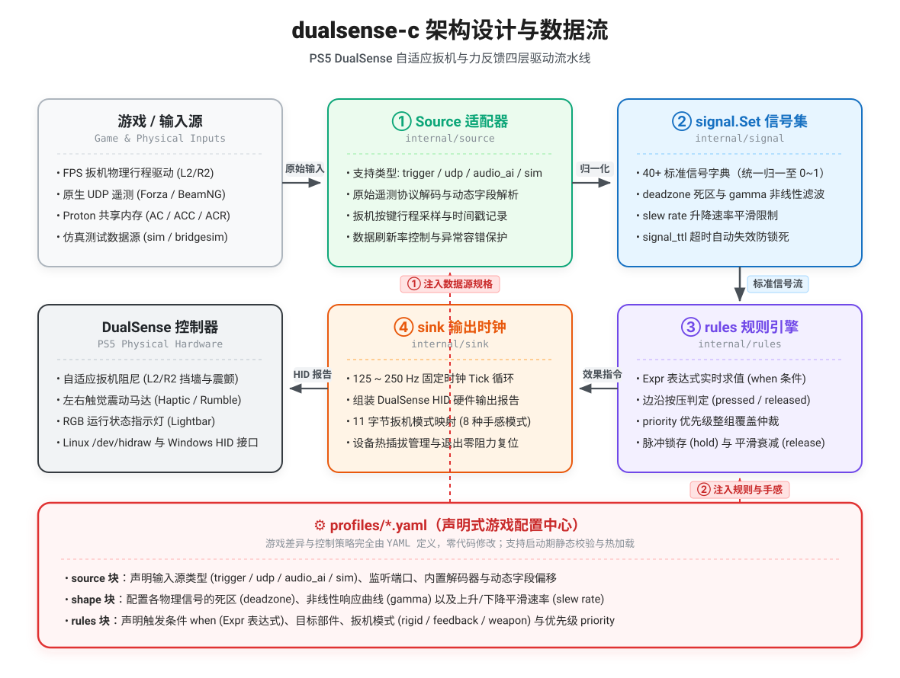

# dualsense-c

**dualsense-c** 是专为 **PS5 DualSense (DS5)** 控制器设计的通用自适应扳机与力反馈驱动框架。

架构采用「信号源（Source）→ 归一化信号（Signal）→ 规则引擎（Rules）→ 硬件输出（Sink）」四层解耦设计，硬件驱动与游戏逻辑完全分离。适配新游戏仅需编写声明式 YAML Profile，无需修改或重新编译程序。

- **全游戏通用（输入驱动）**：不依赖游戏支持，读取控制器自带的 L2/R2 扳机行程与按键，实现瞄准挡墙与射击后坐力反馈。
- **全传感器与手柄状态接入**：内置解析 6 轴运动传感器（陀螺仪角速度 / 加速度计）、触控板坐标、电池电量与充电状态，支持独立控制静音键 LED 与 5 颗玩家指示灯。
- **音频 AI 事件与材质探测（实验性）**：支持通过伴生小模型（Google YAMNet ONNX，纯 CPU INT8）实时分析系统游戏声音，为无遥测游戏识别物理材质（水洼/铁网/沙地）与战斗音效（枪声/爆炸），隔空实现高维触感反馈。
- **原生遥测支持**：内置支持 Forza Horizon 4/5（UDP 5300）、BeamNG / Live for Speed（OutGauge 4444），并提供 DiRT Rally / EA WRC / F1 系列的字段级动态校准能力。
- **Proton / Wine 共享内存桥接**：针对 Assetto Corsa / ACC / AC Rally 等依赖 Windows 命名共享内存（`acpmf_physics`）的游戏，提供轻量 Windows 桥接程序 `ds5bridge.exe`，在 Proton 前缀内读取数据并回传至原生守护进程。
- **纯 Go 实现、零 CGO 依赖**：Linux 环境原生读写 `/dev/hidraw`，Windows 环境直接调用 HID API。
- **高确定性与容错机制**：信号超时自动降级、力反馈释放平滑衰减（防止机械突弹）、配置启动期编译校验。

<p align="center">
  
</p>
<p align="center">
  <sub>（注：架构图源文件见 <a href="docs/architecture.excalidraw">docs/architecture.excalidraw</a>，支持在 <a href="https://excalidraw.com">Excalidraw</a> 中导入编辑）</sub>
</p>

---

## 目录

- [系统架构](#系统架构)
- [快速开始](#快速开始)
- [DS5 硬件能力与支持度](#ds5-硬件能力与支持度)
- [游戏支持矩阵](#游戏支持矩阵)
- [共享内存游戏支持（AC / ACC / AC Rally）](#共享内存游戏支持ac--acc--ac-rally)
- [命令行工具](#命令行工具)
- [Profile 配置规范](#profile-配置规范)
- [扳机效果与参数](#扳机效果与参数)
- [标准信号列表](#标准信号列表)
- [新游戏遥测校准指南](#新游戏遥测校准指南)
- [平台支持（Linux / Windows）](#平台支持linux--windows)
- [故障排查](#故障排查)
- [目录结构](#目录结构)
- [协议参考](#协议参考)
- [功能矩阵与开发进度](#功能矩阵与开发进度)
  - [核心功能与跨平台进度矩阵](#核心功能与跨平台进度矩阵)
  - [后续演进规划（Roadmap）](#后续演进规划roadmap)
- [发行包组件说明](#发行包组件说明)
- [许可证](#许可证)

---

## 系统架构

传统方案通常将内存/遥测读取与底层扳机控制逻辑紧耦合，适配新游戏需要修改核心代码。本项目将其划分为四层独立流水线：

| 分层 | 职责定义 | 适配新游戏时的变动 |
|---|---|---|
| **Source** | 接入游戏状态并转为标准化信号（`trigger` 输入驱动 / `udp` 遥测 / `audio_ai` 音频 AI 事件探测 / `sim` 虚拟模拟） | 原生遥测与 AI 探测调整 YAML；无新协议无需修改代码 |
| **signal.Set** | 信号归一化、时间戳追踪、过期判定，以及死区（deadzone）与变化率限制（slew rate）处理 | 框架底层维护，无需修改 |
| **rules** | 声明式规则引擎，通过表达式将信号映射为扳机、马达及灯条动作，支持优先级、锁存与衰减 | 仅编写/修改 Profile YAML |
| **sink** | 固定时钟周期（125~250 Hz）组装并写入 HID 输出报告，负责设备热插拔与退出重置 | 框架底层维护，无需修改 |

### 核心设计特性

1. **状态失效安全（Fail-Safe）**：规则支持 `has("signal")` 判定。当数据流中断超出 `signal_ttl` 阈值时规则自动停用，避免将缺失信号误认为零值而锁定扳机。
2. **平滑释放衰减**：力反馈效果失效时，按照配置的 `release` 时间平滑衰减至零，消除机械突弹手感。
3. **配置即文档**：`internal/profile/builtin/*.yaml` 既是内嵌默认配置，也是标准的编写范例。

---

## 快速开始

### 1. 环境要求

- Go 1.24+
- Linux（支持 hidraw）或 Windows（HID 接口）
- PS5 DualSense 控制器，**推荐使用 USB 有线连接**（蓝牙协议受带宽及传输格式限制，稳定性略低于有线）。

### 2. 编译构建

```bash
make                   # 编译生成 bin/ds5d、bin/ds5ctl、bin/ds5vpad、bin/ds5radio、bin/ffclient、bin/hidprobe 以及 bin/ds5bridge.exe
make windows           # 交叉编译生成全套 Windows 可执行文件（纯 Go，无需外部工具链）
make build-windows-onnx # 交叉编译带进程内 ONNX 推理的 bin/ds5d-onnx.exe
```

### 3. 配置 Linux 权限（udev 规则，一次性）

```bash
make install-udev
# 等价于：
#   sudo cp udev/70-dualsense.rules udev/71-ds5vpad.rules /etc/udev/rules.d/
#   sudo udevadm control --reload-rules && sudo udevadm trigger
```

安装后请**重新插拔控制器**以应用规则。

### 4. 硬件自检

```bash
./bin/ds5ctl list        # 查看识别到的 DualSense 控制器
./bin/ds5ctl test        # 硬件自检：依次测试震动、L2 阻力、R2 阻力及反馈模式
./bin/ds5ctl bench       # 轮巡播放 8 种扳机效果用于手感对比（按 Ctrl+C 退出）
```

若存在多个控制器接口，可使用 `-hidraw /dev/hidrawN` 参数显式指定设备节点。

### 5. 启动运行

**射击 / 动作游戏（输入驱动，全游戏免配）**

```bash
./bin/ds5d -profile fps
```

- L2（瞄准）：前 55% 行程提供渐进阻力（模拟机械扳机挡墙），越过阈值后阻力释放。
- R2（开火）：行程达到 85% 时触发右马达后坐力脉冲。

**原生遥测竞速游戏**

```bash
./bin/ds5d -profile forza-horizon     # Forza Horizon 4/5、Forza Motorsport
./bin/ds5d -profile beamng            # BeamNG.drive、Live for Speed
```

**共享内存竞速游戏（AC / ACC / AC Rally）**

推荐使用一键脚本进行两段式启停（避免 Proton 前缀锁冲突，自动管理守护进程与桥）：

```bash
# 两段式启动：
./scripts/ds5-acr.sh start      # 阶段 1：启动 Linux 原生 ds5d 守护进程（AppID 默认 3917090 = AC Rally）
# 在 Steam 中正常启动游戏（AC Rally / AC / ACC）并进入赛段后：
./scripts/ds5-acr.sh bridge     # 阶段 2：向 Proton 前缀注入共享内存桥

# 或使用全自动模式（启动 ds5d 并自动监听等待游戏启动后注入桥）：
./scripts/ds5-acr.sh auto

./scripts/ds5-acr.sh status     # 查看进程运行状态、游戏运行状态与当前信号
./scripts/ds5-acr.sh stop       # 全部停止，手柄交还 Steam
./scripts/ds5-acr.sh logs       # 同时实时跟踪 ds5d 与桥日志
# 若游戏重启后桥断连卡死，重新执行 bridge 注入或 restart 即可：
./scripts/ds5-acr.sh bridge

# 可用环境变量覆盖：DS5_APPID / DS5_PROFILE / DS5_RATE
DS5_APPID=805550 DS5_RATE=250 ./scripts/ds5-acr.sh start
```

手动等价命令：

```bash
make bridge                                   # 编译 Windows 桥接程序 bin/ds5bridge.exe
./bin/ds5d -profile assetto-corsa -rate 125 &  # 启动后台守护进程
./scripts/launch-bridge.sh 3917090             # 在 Proton 前缀中启动桥接程序
# Steam AppID 对照：AC: 244210 | ACC: 805550 | AC Rally: 3917090
```

**配置联调模式（无需连接物理手柄）**

```bash
./bin/ds5d -dry-run -profile fps -source sim -trace
```

### 6. 常驻后台运行

```bash
nohup ./bin/ds5d -profile fps >> /tmp/ds5d.log 2>&1 &
```

---

## DS5 硬件能力与支持度

DualSense (DS5) 的物理执行上限**不在 HID 协议，而在信号输入源**。控制器插入 PC 后，实际暴露为两个独立通道：**HID 控制接口** 与 **UAC2 4 声道 USB 声卡**。

| 硬件能力分类 | 支持度 | 驱动通道与技术实现 |
|---|---|---|
| **自适应阻力扳机 (L2/R2)** | [支持] 100% | HID 报告（11 字节协议），语义封装 8 种模式 + 裸参数 `p0..p9` |
| **传统马达震动 (L/R)** | [支持] 100% | HID 报告（0~255 幅度），支持正弦波与方波动态调幅 |
| **全部按键 / 摇杆 / 扳机行程** | [支持] 100% | HID 输入报告解析，支持高敏度连续量与边沿检测 |
| **6 轴运动传感器 (IMU)** | [支持] 100% | 陀螺仪角速度 (`gyro_x/y/z`) + 线性加速度 (`accel_x/y/z`) 归一化 |
| **触控板坐标 / 电池与充电状态** | [支持] 100% | 1920×1080 触控坐标 (`touch_x/y`)、电量 (`battery`) 与充电标志 (`charging`) |
| **指示灯全系控制** | [支持] 100% | RGB 状态灯条 (`lightbar`)、静音键指示灯 (`mute_led`)、5 颗玩家指示灯 (`player_leds`) |
| **高清音圈触感 (Voice-Coil)** | [支持] 可用（Linux 实测） | `sink/haptics` 往 USB 声卡 Ch3/4 写 48kHz PCM（`haptic_left/haptic_right`）。**前提**：HID 报告空闲时不得声明 `COMPATIBLE_VIBRATION/HAPTICS_SELECT`，否则执行器被锁在 HID 引擎上、音频流被忽略 |
| **手柄内置扬声器 (Companion Audio)** | [支持] 100%（全品类伴生语音与电台） | Ch1/2 独立路由（与 Ch3/4 音圈物理隔离）。支持声明式 `target: speak` / `target: radio`、4 种 DSP 声学风格（对讲机/原声/机甲/耳语）、Qwen2.5-0.5B 本地端侧大模型情境推理与 `ds5radio` 伴生广播器 |

> **Wiki**：分主题的教程与排错手册 —— <https://github.com/npc1607/dualsense-c/wiki>
> （源文件在 `wiki/`，`./scripts/publish-wiki.sh` 一键发布）
>
> 音频 AI 的接入方式、推理流程、HD 触感触发路径与调优见
>  **[音频 AI 接入与 HD 触感（含流程图）](docs/audio-ai-haptics.md)**
>
> 音频触感与力反馈镜像的实现细节、真机实测数据与踩坑记录见
>  **[音频触感与力反馈镜像：设计与踩坑记录](docs/audio-haptics-and-ffb.md)**
>
> 完整 14 项硬件特性拆解、信号源延迟差距、Astro's Playroom 触感还原度对比及 Linux & Windows 双平台音频触感方案，详见专属技术方案：
>  **[PS5 DualSense 硬件能力、驱动边界与高清触感技术方案 (docs/hardware-capabilities.md)](docs/hardware-capabilities.md)**

---

## 游戏支持矩阵

### 3. 游戏支持矩阵

#### A. 输入驱动模式（无需游戏支持，全游戏通用）

| 数据源类型 | 工作机制 | 支持状态 |
|---|---|---|
| `trigger` 源 | 解析控制器自身的输入报告（L2/R2 行程、按键状态、摇杆偏移），通过规则引擎生成阻力、挡墙与震动反馈 | [支持] 生产就绪 |
| `audio_ai` 源 | 监听本地伴生探测器（YAMNet ONNX 实时分析系统声卡混音），输出水洼/铁板/枪声等事件信号 |  实验性可用（详见 [方案文档](docs/audio-ai-event-detection.md)） |

适用于 FPS、TPS 及各类动作游戏。不受游戏本身是否支持 DualSense 限制（需注意避免与 Steam Input 的震动控制产生抢占冲突）。

### 2. 原生 UDP 遥测模式

| 游戏名称 | 默认端口与格式 | 解码器 | 支持状态 |
|---|---|---|---|
| Forza Horizon 4 / 5、Forza Motorsport 7 / 2023 | UDP **5300**（Data Out 模式，数据格式需设置为 **Dash**） | `forza` | [支持] 内置 |
| BeamNG.drive | UDP **4444**（选项 → 其他 → 启用 OutGauge） | `outgauge` | [支持] 内置 |
| Live for Speed | UDP **4444**（选项 → 外设 → OutGauge） | `outgauge` | [支持] 内置 |
| DiRT Rally 2.0 / EA Sports WRC / DiRT 4 | UDP **20777**（配置 → 启用 UDP 遥测） | `dirt` + `fields` | [模板] 需字段校准（各版本结构差异较大，需使用 `sniff` 校准） |
| 理查德·伯恩斯拉力赛（RBR / RSF，NGP 插件） | UDP **6776**（Plugins → NGP 按 `U` 打开 UDP 遥测） | `fields` | [支持] 内置（`rbr`，按 NGP `TelemetryData.h` 的 664 字节布局） |
| F1 22 / 23 / 24 | UDP **20777** | `fields` | [模板] 需字段校准（按年份版本校准字段偏移） |
| Assetto Corsa / ACC / AC Rally | 共享内存 `acpmf_physics` → `ds5bridge.exe` → UDP **9999** | `acshm` | [支持] 内置（采用实测偏移定义） |
| rFactor 2 / LMU、ETS2 / ATS | 共享内存 | — | [规划中] |
| iRacing | 内存映射 SDK | — | [规划中] |

> **说明**：Codemasters 系列（DiRT / F1 / EA WRC）在跨代版本中多次变更报文结构，且同一版本可能混合传输不同长度的数据帧。硬编码偏移极易导致扳机动作异常。因此本项目采用「声明式字段配置（fields）+ 现场抓包校准（sniff）」机制，提供精准适配能力。

---

## 共享内存游戏支持（AC / ACC / AC Rally）

此类游戏的物理遥测数据写入 Windows 命名共享内存（如 `acpmf_physics`）。在 Linux 环境下，Proton/Wine 进程运行在独立命名空间中，原生 Linux 进程无法直接读取该内存段。

本项目通过运行在同一 Proton 前缀内的轻量 Windows 进程 `ds5bridge.exe` 提取物理数据，并通过本机的环回 UDP 发送至原生 `ds5d`：

```
acc.exe (Proton 进程) ──写──► acpmf_physics (Wine 共享内存)
                                      ▲
ds5bridge.exe (同 Proton 前缀) ──读───┘ ──► UDP 127.0.0.1:9999
                                                    ▼
ds5d (Linux 原生守护进程) ──► 表达式规则 ──► DualSense 控制器
```

### 启动流程

```bash
make bridge                                  # 交叉编译 Windows 桥接程序
./bin/ds5d -profile assetto-corsa &          # 启动原生守护进程（等待数据输入）
./scripts/launch-bridge.sh 805550            # 注入 ACC（AC: 244210, AC Rally: 3917090）
# 手动启动方式：
protontricks-launch --appid 805550 ./bin/ds5bridge.exe -layout acc -debug
```

### 桥接程序运行保障

- 每 2 秒轮询一次共享内存连接，**允许先于游戏启动**；
- 若检测到 `packetId` 连续 2 秒未递增，判定当前对局已结束并自动重连，无需重启桥接进程；
- 具备异常值校验逻辑，出现字段越界或类型不匹配时输出 `layout mismatch?` 告警并跳过异常帧，防止错误数据影响控制器。

### 无游戏环境的链路验证

可运行 `tools/bridgesim` 模拟桥接数据流：

```bash
# 终端 A：启动模拟发送端
go run ./tools/bridgesim -port 9999

# 终端 B：验证数据链路与规则求值
./bin/ds5d -dry-run -profile assetto-corsa -trace
```

### 桥接通信协议

桥接程序与守护进程之间采用自描述定长紧凑协议：

```
偏移  字段       类型      说明
0     magic      uint32    协议标识 "DS5B" (0x42355344)
4     version    uint16    版本号（当前固定为 1）
6     count      uint8     有效数据项数量
7     _          uint8     对齐保留位
8     fields[]   struct    数组项：{ id uint8, value float32 }（id 对应 internal/signal.Standard 下标）
```

扩展新遥测指标仅需更新 `internal/bridge/layout.go`，无需变动主通信链路。

---

## 命令行工具

### `ds5d`（核心守护进程）

| 参数 | 默认值 | 说明 |
|---|---|---|
| `-profile` | `fps` | 指定加载的 Profile 名称（内置）或自定义 `.yaml` 绝对/相对路径 |
| `-profiles` | 空 | 指定自定义 Profile 的扫描目录 |
| `-source` | 空 | 覆盖 Profile 中声明的 Source 类型（如 `sim`、`trigger`、`udp`、`audio_ai`） |
| `-hidraw` | 自动识别 | 显式指定控制器设备节点路径（如 `/dev/hidraw3`） |
| `-rate` | `125` | HID 报告发送频率（Hz），DualSense USB 最高支持 250 Hz |
| `-dry-run` | 禁用 | 纯逻辑仿真模式，不打开物理控制器，控制台打印输出帧 |
| `-trace` | 禁用 | 调试开关，周期性输出当前计算的信号采样值 |
| `-list` | 禁用 | 输出所有内置 Profile 列表后退出 |
| `-ipc-broadcast` | `127.0.0.1:9997` | IPC 遥测信号广播端点（SIG1 协议），用于向伴生工具（如 ds5radio）广播信号流（为空则禁用） |
| `-version` | 禁用 | 打印当前版本信息后退出 |

### `ds5ctl`（设备与配置工具）

| 子命令 | 说明 |
|---|---|
| `list` | 枚举系统中接入的 DualSense 设备 |
| `profiles [-dir <path>]` | 查看内置及指定目录下的可用 Profile 列表 |
| `check -profile <path>` | 离线编译并验证 YAML 规则有效性（不连接硬件） |
| `test` | 硬件诊断自检（依次执行震动渐变与扳机阻力测试） |
| `bench [-trigger l2\|r2\|both]` | 逐项测试控制器支持的 8 种扳机效果模式 |
| `watch` | 实时输出控制器上行输入报告解析结果（用于按键映射校准） |
| `sniff -listen <addr>` | 十六进制转储指定端口接收到的 UDP 遥测数据包（用于字段逆向校准） |
| `version` | 打印工具版本信息 |

### `ds5vpad`（虚拟手柄 / 力反馈捕获）

Uinput 虚拟 Xbox 360 手柄 + 独占物理手柄，把手柄输入转发给游戏，同时把游戏发来的
力反馈（FF_RUMBLE）发布到 UDP `127.0.0.1:9998` 供 `source/ffb` 消费。

| 参数 | 默认值 | 说明 |
|---|---|---|
| `-proto` | `xinput` | 虚拟手柄协议：`xinput`（Xbox 360，现代标准）或 `dinput8`（罗技 Dual Action 6轴12键，适用 RBR 等 2000s 经典游戏） |
| `-name` | 协议默认名 | 游戏看到的设备名（缺省由协议自动决定） |
| `-grab` | 自动识别 | 要独占的物理 evdev 节点 |
| `-publish` | `127.0.0.1:9998` | 力反馈发布地址 |
| `-hz` | `60` | 发布频率 |

`ffclient` 用于不开游戏验证力反馈链路：`./bin/ffclient -dev /dev/input/eventN`。

### `ds5radio`（伴生广播 / 赛车领航与情境语音助手）

通过 DualSense 控制器内置前置扬声器（音频通道 1 & 2：FL/FR）播放车队电台（Team Radio）、路书领航（Pacenotes）、战术与强敌警报，与通道 3 & 4 触觉双音圈物理正交共存。支持内置规则音频切片合成，以及外接端侧本地小语言模型（Qwen2.5-0.5B）进行动态拟真无线电对话。

| 子命令 | 说明 |
|---|---|
| `test` | 在手柄前置扬声器上播放车队无线电/拉力领航测试语音（带真实对讲机 PTT 握掣杂音） |
| `play <clip>` | 播放指定的内置音频切片（如 `tire_slip`, `box_this_lap`, `engine_redline`） |
| `list` | 列出 `assets/radio/` 目录下全部可用音频切片 |
| `listen` | 启动实时遥测监听器，根据信号规则或 LLM 自动广播情境语音 |

| 常用参数 | 默认值 | 说明 |
|---|---|---|
| `-ipc` | `127.0.0.1:9997` | 连接 ds5d 的 IPC 遥测广播端点（留空则回退监听 UDP 遥测） |
| `-listen` | `127.0.0.1:9999` | UDP 遥测接收地址（当 `-ipc` 为空时生效） |
| `-decoder` | `acshm` | UDP 遥测解码器（`acshm`、`forza`、`dirt`、`outgauge`） |
| `-persona` | `rally` | 伴生人格：`rally`（拉力领航）、`f1`（F1 比赛工程师）、`mech`（机甲车载 AI）、`souls`（魂系伴生）、`isaac`（肉鸽伴生） |
| `-llm` | 禁用 | 启用端侧本地小语言模型动态情境推理与语音生成 |
| `-llm-endpoint` | `127.0.0.1:9995` | 本地 LLM HTTP 推理服务端点（环境变量 `$DS5_LLM_ENDPOINT`） |
| `-llm-model` | `qwen2.5:0.5b` | LLM 模型标识符（环境变量 `$DS5_LLM_MODEL`） |
| `-sink` | 自动识别 | 覆盖音频输出 Sink（默认自动路由至 DualSense 内置声卡） |
| `-clips` | 自动识别 | 指定 `.wav` 无线电切片存放目录（默认扫描 `assets/radio`） |

---

## Profile 配置规范

```yaml
name: my-game                # 必填：Profile 唯一标识
title: 示例配置               # 显示名称
description: |               # 详细描述信息
  配置说明与适配版本记录

source:
  type: udp                  # 数据源类型：trigger | udp | audio_ai | sim
  listen: "0.0.0.0:5300"     # 监听地址与端口
  decoder: forza             # 数据解码器：forza | outgauge | dirt | fields | auto
  rate_hz: 60                # 数据采样频率上限
  # dump: true               # 启用数据包长度与内容转储（调试用）

shape:                       # 可选：信号前置处理与整形
  brake:    { deadzone: 0.02, gamma: 1.0, slew_up: 60, slew_down: 200 }
  throttle: { deadzone: 0.02, gamma: 0.9 }

safety:
  signal_ttl: 500ms          # 信号超时时限，超时判定为数据源离线
  release: 300ms             # 规则失效后的力反馈衰减时长（防止扳机突弹）
  status_lightbar: true      # 缺省状态下使用指示灯展示连接状态（绿色：就绪，黄色：等待数据）

signals: [custom_boost]      # 可选：声明自定义扩展信号名

rules:
  - name: l2-brake
    when: 'has("brake") && brake > 0.01'     # 激活条件，未定义则始终匹配
    target: l2                               # 输出目标：l2 | r2 | rumble_left | rumble_right | haptic_left | haptic_right | lightbar | player_leds | mute_led | speak | radio
    effect: rigid                            # 扳机模式（见效果表）
    priority: 10                             # 执行优先级，数值大者优先覆盖
    hold: 0ms                                # 脉冲类信号触发后的最短保持时长
    params:                                  # 效果参数映射表达式
      start: "0"
      force: "clamp(18 + 237 * brake, 0, 255)"

  - name: recoil
    when: 'pressed("r2_full")'
    target: rumble_right
    priority: 50
    hold: 130ms
    value: "230"
    modulate: { type: sine, hz: 24, depth: 0.65 }

  # 伴生语音与车队电台广播（通过手柄正面扬声器播放，不占用双音圈触感）
  - name: low-hp-warning
    when: "has('hp') && hp > 0 && hp <= 1.0"
    target: speak                            # speak: 伴生语音 / radio: 车队对讲机
    clip: "low_hp_warning"                   # 音频切片名（位于 assets/radio/*.wav）
    priority: 85                             # 执行优先级（数值大者可抢占播报）
    cooldown: 8s                             # 防重复触发冷却时长
    text: "生命值垂危，快找红心！"             # 自然语言说明（供 LLM 理解与日志记录）
```

### 音圈触感（`haptics:` 块）

> **[实测状态]（Linux, fw 0x0110002a）：可用。**
> 关键前提：HID 输出报告的 `valid_flag0` 是**应用掩码**。若在 motor 字节为 0 时
> 仍声明 `COMPATIBLE_VIBRATION|HAPTICS_SELECT`，固件会把执行器锁在 HID 震动
> 引擎上（幅度 0），**音频通道的音圈信号会被完全忽略**。本项目只在真的有震动
> 时才声明这两个位，空闲时把执行器交还给音频流。
> 另外 `valid_flag0` 的 BIT4-7（音量/audio_control）必须保持清零，否则会静音
> 整个 USB 音频 DAC（表现为连扬声器都没声音）。
>
>  完整设计与踩坑记录：[docs/audio-haptics-and-ffb.md](docs/audio-haptics-and-ffb.md)

DS5 同时是一块 4 声道 48kHz USB 声卡，Ch3/4 直连左右音圈。HID 震动字节只能表达
「振幅 + 一个调幅频率」，是音圈的低分辨率近似；写 PCM 才能真正还原频谱与瞬态。

```yaml
haptics:
  mode: passthrough   # synth=合成载波 | passthrough=游戏音频直通（HD）
  target: auto        # PipeWire sink 名，或 auto 自动找 DualSense
  low_hz: 55          # passthrough 通带下限
  high_hz: 200        # 上限
  carrier_hz: 55      # synth 模式的基频
  gain: 0.7           # 总输出增益
  command: "pacat --playback --device={target} --rate={rate} --channels={channels} --format=s16le --raw"
```

规则用 `haptic_left` / `haptic_right` 两个 target 驱动它（与 `rumble_*` 同构，支持 `value` + `modulate`）。

> 实测注意事项：
> 1. `pw-record` / `pw-cat` 的 `--target` 在部分 PipeWire 版本上会被静默忽略，
>    因此默认使用 PulseAudio 兼容的 `parec` / `pacat`。
> 2. `pacat` 必须带 `--channel-map=front-left,front-right,rear-left,rear-right`，
>    否则默认的 4 声道布局会把 Ch3/4 混进耳机通路，音圈收不到数据。
> 3. 输出报告的 `valid_flag0` 必须是 `0x0F`；`0xFF` 会把未填充的音量字段置 0，
>    从而静音整个 USB 音频 DAC（实测曾导致「完全没声音」）。

### 表达式语法

规则中的 `when` 条件、`params.*` 参数以及 `value` 字段均由 [expr-lang](https://expr-lang.org) 编译为高效字节码执行：

- **变量范围**：所有[标准信号](#标准信号表)（未定义或过期时为 `0`）。
- **内置数学函数**：`min`, `max`, `ceil`, `floor`, `round`, `sqrt`, `pow`。
  [注意] 绝对值必须用扩展函数 `absf(x)`：`abs` 是 ABS 介入信号名，信号名会遮蔽同名函数。
- **扩展工具函数**：

| 函数签名 | 说明 |
|---|---|
| `clamp(x, lo, hi)` | 数值区间夹取 |
| `lerp(a, b, t)` | 线性插值计算 |
| `smoothstep(e0, e1, x)` | 埃尔米特插值，提供平滑阶梯过渡 |
| `absf(x)` | 绝对值（`abs` 被 ABS 信号占用，不能用作函数） |
| `has("sig")` | 检测目标信号当前是否处于有效刷新周期内（返回 bool） |
| `pressed("sig")` | 上升沿检测：当前帧从 `< 0.5` 跃迁至 `≥ 0.5`（返回 bool） |
| `released("sig")` | 下降沿检测：当前帧从 `≥ 0.5` 跌落至 `< 0.5`（返回 bool） |
| `held("sig")` | 电平检测：当前值 `≥ 0.5`（返回 bool） |
| `sec()` | 守护进程自启动以来的运行秒数（用于构造周期性时间函数） |
| `sin(x)`, `cos(x)` | 三角函数计算（弧度制），常用于构建平滑充电呼吸灯与周期性物理脉冲 |
| `curve(x, x0, y0, x1, y1, ...)` | 多点折线/曲线查表插值，按输入值区间线性拟合（常用于自定义直驱 FFB 力矩曲线） |
| `scurve(x, power)` | S 形软饱和曲线（输入范围 `[0, 1]`），模拟非线性力学软过渡与渐近防打手 |

所有 Profile 在程序加载时执行编译期校验。若存在未声明变量、函数名拼写错误或类型推导异常，进程将立即终止并报错。建议使用 `ds5ctl check` 进行静态预检。

### 规则优先级与覆盖机制

`priority` 数值较小的规则先执行，数值较大者后执行。当多个规则作用于同一个 `target` 时，高优先级规则**整组覆盖**低优先级输出（而非数值累加）：

```yaml
  - {name: aim,  when: "l2 < 0.5", target: l2, effect: feedback, priority: 10, ...}
  - {name: off,  when: "l2 >= 0.5", target: l2, effect: off,     priority: 20}
```

当行程超过设定阈值时，优先级为 20 的规则将接管并完全释放阻力。

---

## 扳机效果与参数

DualSense 的每个扳机通道在 HID 报告中占用 11 字节（1 字节模式标识 + 10 字节控制参数）。各模式参数严格对应 Linux 内核 `hid-playstation` 标准：

| 模式名称 | 模式 ID | 语义参数 | 典型效果说明 |
|---|---|---|---|
| `off` | 0x00 | — | 关闭力反馈，行程自由 |
| `rigid` | 0x01 | `start`(0..9), `force`(0..255) | 达到指定行程后施加恒定阻力 |
| `section` / `pulse` | 0x02 | `start`, `end` | 仅在指定行程区间内施加阻力 |
| `feedback` | 0x21 | `start`, `strength`, `force` | 阻力随行程递增（适用于瞄准镜阻力挡墙） |
| `weapon` | 0x22 | `start`, `amp_a`, `amp_b`, `freq` | 两段式击发触感（模拟机械扳机击锤释能） |
| `vibration` | 0x23 | `start`, `amplitude`, `freq` | 指定行程区间内的高频振动 |
| `slope_feedback` | 0x24 | `start`, `end`, `start_force`, `end_force` | 行程范围内的斜坡线性阻力 |
| `slope_weapon` | 0x25 | `start`, `end`, `amp_a`, `amp_b`, `freq` | 带阻力梯度的两段式扳机 |
| `machine` | 0x26 | `start`, `end`, `freq`, `period` | 周期性脉冲冲击（模拟全自动连发） |

除语义参数外，所有模式均支持直接传递底层参数 `p0` 至 `p9`，便于测试固件新特性。

针对震动通道（`rumble_left` / `rumble_right`），支持通过 `modulate` 定义调幅：

```yaml
modulate: { type: sine, hz: 16, depth: 0.85 }   # 正弦调幅（适用于 ABS 刹车脉冲）
modulate: { type: square, hz: 30, depth: 1.0 }  # 方波调幅（适用于机械碰撞反馈）
```

---

## 标准信号列表

| 类别 | 信号名称与取值规范 |
|---|---|
| **车辆遥测** | `throttle`, `brake`, `clutch`, `slip`, `lockup`, `abs`, `tc`, `rumble`：归一化至 `[0, 1]`<br>`steer`：方向盘转角，取值范围 `[-1, 1]`<br>`speed`：时速（km/h）<br>`rpm`：转速，按红线转速归一化至 `[0, 1]`<br>`gear`：档位数值<br>`accel_g`, `lat_g`：加速度 G 值<br>`surface`：路面材质标识<br>`slip_fl`, `slip_fr`, `slip_rl`, `slip_rr`：四轮独立滑移率（`0.0 ~ 1.0`） |
| **手柄按键与摇杆** | `l2`, `r2`：模拟量行程，取值范围 `[0, 1]`<br>`l2_full`, `r2_full`：行程触底开关（bool）<br>`l1`, `r1`, `cross`, `circle`, `square`, `triangle`, `up`, `down`, `left`, `right`, `ps`, `touchpad`, `mute`：按键状态（bool）<br>`lx`, `ly`, `rx`, `ry`：摇杆坐标，取值范围 `[-1, 1]`<br>`stick_l`, `stick_r`：摇杆下压开关（bool） |
| **手柄传感器与状态** | `gyro_x`, `gyro_y`, `gyro_z`：6 轴角速度（小端 int16 归一化至 `[-1, 1]`）<br>`accel_x`, `accel_y`, `accel_z`：6 轴线性加速度（小端 int16 归一化至 `[-1, 1]`）<br>`touch_x`, `touch_y`：触控板首个触点归一化坐标 `[0, 1]`（基于 1920×1080 分辨率）<br>`touch_active`：触控板是否处于触摸接触状态（bool）<br>`battery`：电池电量等级（`0.0 ~ 1.0`，以 10% 步长递增）<br>`charging`：电池充电中标志（bool） |
| **音频包络（source/audio）** | `bass`（20~110Hz）、`mid`（160~450Hz）、`loudness`（全带）：归一化 `[0, 1]`，已做 attack/release 平滑 |
| **瞬态检测（source/audio）** | `onset`：fast/slow 包络之差，对背景音量免疫，用于枪声/撞击起音 |
| **音频 AI（YAMNet, `-tags onnx`）** | `surface_water`, `surface_metal`, `surface_wood`, `surface_gravel`：地面物理材质置信度（`0.0 ~ 1.0`）<br>`audio_gunshot`, `audio_explosion`, `audio_impact`：交火与受击事件置信度（`0.0 ~ 1.0`） |
| **力反馈（source/ffb）** | `ffb_left`、`ffb_right`：虚拟手柄捕获到的游戏 rumble 幅度，`[0, 1]` |
| **电台与战术进站** | `box`：车队无线电进站指令（bool / 0 或 1）<br>`pit`：赛车处于维修区标志（bool / 0 或 1） |
| **全品类伴生信号** | `hp`：角色生命值 / 血量（以撒红心、魂系 HP 等）<br>`stamina`：角色精力 / 体力值（`0.0 ~ 1.0`）<br>`mana`：角色法力 / 能量值（`0.0 ~ 1.0`）<br>`hazard`：强敌 / Boss 房 / 高危环境预警等级（`0.0 ~ 1.0`） |
| **自定义扩展** | `custom0` ~ `custom3`：供特殊遥测项绑定的用户自定义通道 |

各解码器的具体映射实现可参阅 `internal/source/udp/decoders.go`。

---

## 新游戏遥测校准指南

对于未内置专用解码器的 UDP 遥测游戏，可通过动态字段解析（`fields`）模式在几分钟内完成适配：

1. **抓包监听**：进入驾驶状态并规律触发油门/刹车操作，执行抓包监听：
   ```bash
   ./bin/ds5ctl sniff -listen :20777
   ```
2. **分析报文**：观察终端输出的数据包长度，定位在 `0.0 ~ 1.0` 之间随操作变化的 4 字节偏移（通常为单精度浮点数 `f32` 格式）。
3. **编写 Profile**：在 YAML 中声明提取规则，无需修改 Go 代码：
   ```yaml
   source:
     type: udp
     decoder: fields
     fields:
       speed:    { off: 8,   fmt: f32, scale: 3.6 }  # 转换 m/s 为 km/h
       throttle: { off: 116, fmt: f32 }
       brake:    { off: 120, fmt: f32 }
       gear:     { off: 132, fmt: u8 }
     derived:
       slip: "max(abs(slip_fl), abs(slip_fr))"
   ```
4. **离线校验**：执行仿真命令检查数值解析是否正常：
   ```bash
   ./bin/ds5d -dry-run -profile custom-game -trace
   ```
5. **正式运行**：移除 `-dry-run` 启动正常服务。

字段类型 `fmt` 支持 `u8`, `s8`, `u16`, `s16`, `u32`, `s32`, `f32`，并支持配置线性缩放参数 `scale` 与 `bias`（计算式：`value = raw * scale + bias`）。

---

## 平台支持（Linux / Windows）

硬件控制层、音频管线与虚拟手柄层均已实现跨平台解耦：

- **Linux**：原生操作 `/dev/hidraw*` 设备节点，使用 PipeWire/PulseAudio（`parec`/`pacat`）采集与输出音圈信号，通过 `/dev/uinput` 创建虚拟手柄。
- **Windows**：通过 SetupAPI + `hid.dll` 读写 HID 报告，基于纯 Go 的 Core Audio / WASAPI COM（`internal/wasapi`）实现系统回环采集与 4 声道（`SPEAKER_QUAD` `0x33`）音圈直写，并通过 `ViGEmClient.dll` 实现虚拟手柄（Xbox 360 与 DirectInput 8 DualShock 4）与原生力反馈回调（`ds5vpad.exe`）。

> **Windows 部署说明**：
> Windows 默认构建保持 100% 纯 Go（`CGO_ENABLED=0`）。部署至 Windows 时需注意：
> 1. 音圈功能需使用 USB Type-C 有线连接（DualSense 仅在 USB 模式下暴露 4 声道声卡）；
> 2. 使用 `ds5vpad.exe` 虚拟手柄需预装 [ViGEmBus](https://github.com/nefarius/ViGEmBus/releases) 驱动并将 `ViGEmClient.dll` 置于同目录或 `PATH`；
> 3. 避免 Steam Input 等具有独占性或优先级的后台驱动抢占控制器震动端口。

```bash
make windows
bin/ds5d.exe -profile fps -trace
```

---

## 故障排查

| 异常现象 | 可能原因 | 推荐处置方式 |
|---|---|---|
| `ds5ctl list` 无法检测到设备 | 物理连接异常 / udev 权限未生效 | 检查 USB 接口连接；确认已执行 `make install-udev` 并重新插拔手柄 |
| 持续输出 `no DualSense found` 并重试 | 设备 VID/PID 未收录或属第三方兼容控制器 | 使用 `-hidraw /dev/hidrawN` 显式指定具体设备路径 |
| 马达可震动，但扳机无力反馈阻力 | 控制器暴露了多个 hidraw 节点且选择了非主通信节点 | 使用 `ds5ctl bench -hidraw /dev/hidrawN` 遍历节点以确认控制端口 |
| 阻力模式与预期不符 | 控制器固件版本差异对模式解析存在微小偏差 | 使用 `ds5ctl bench` 对比 8 种内置效果，选择最适匹配模式 |
| 游戏内动作无响应 | 守护进程未启动或未收到有效数据流 | 添加 `-trace` 参数查看信号接收与解析状态 |
| Forza 系列无遥测数据输入 | 游戏内 Data Out 未开启，或输出格式未选择 **Dash** | 确认游戏设置中的 IP 地址、端口（5300），数据格式必须设为 **Dash**（不能选 Sled） |
| BeamNG.drive 无数据输入 | OutGauge 功能未启用 | 检查「选项 → 其他 → OutGauge 协议」是否正确启用并指向 4444 端口 |
| 尘埃 / F1 遥测数据异常波动 | 报文偏移不匹配 | 使用 `ds5ctl sniff` 重新捕获当前游戏版本的数据包并核准偏移配置 |
| 与 Steam 产生控制冲突 | Steam Input 抢占写入力反馈与震动通道 | 在 Steam 游戏属性中关闭该游戏的 Steam Input 支持 |
| 蓝牙连接下手感断续不稳 | 蓝牙传输抖动或带宽受限 | 优先改用 USB Type-C 有线连接 |

---

## 目录结构

```
cmd/
  ds5d/                   主守护进程（负责 Source → Rules → Sink 链路调度）
  ds5ctl/                 维护与辅助工具（设备检测、配置预检、抓包校准）
  ds5vpad/                虚拟手柄与力反馈捕获守护进程（Linux uinput / Windows ViGEmBus）
  ds5radio/               伴生广播与情境语音工具（车队电台/领航员/端侧 LLM）
  ds5bridge/              Windows 共享内存桥接器（在 Proton / Wine 前缀内或原生 Windows 运行）
internal/
  bridge/                 桥接通信协议定义与共享内存结构（AC/ACC/ACR）
  hid/                    HID 输出报告封装与扳机参数库
  device/                 跨平台设备读写接口（Linux hidraw / Windows HID）
  input/                  DualSense 原始输入报告解析
  signal/                 标准信号字典与时间序列前置处理
  profile/                Profile 结构体定义与内置 YAML 解析
  radio/                  伴生广播系统（DSP 渲染、PTT 滤镜、仲裁器与 LLM 分类器）
  rules/                  表达式解析引擎、优先级控制与状态锁存衰减
  audioai/                YAMNet 推理引擎（ONNX Runtime C API，-tags onnx）
  wasapi/                 Windows Core Audio / WASAPI COM 回环采集与 4 声道渲染后端
  sink/                   高精度时钟驱动与退出状态重置
    haptics/              音圈输出：合成载波 / 游戏音频直通(passthrough)
  vpad/                   虚拟手柄后端（Linux uinput / Windows ViGEmBus + XUSB 编码）
  report/                 传输模式自适应输出报告构建
  source/                 数据源驱动接入实现
    trigger/              手柄按键与扳机行程驱动源
    udp/                  UDP 遥测驱动（Forza / OutGauge / DiRT / ACSHM / Fields）
    audio/                音频包络源（PipeWire monitor / WASAPI Loopback → bass/mid/loudness）
    audioai/              音频 AI 事件与材质探测驱动源（YAMNet/ONNX）
    ffb/                  力反馈源（虚拟手柄捕获的 rumble → ffb_left/right）
    sim/                  离线仿真数据源
assets/radio/             伴生广播与电台音频切片资产（.wav）
udev/
  70-dualsense.rules      Linux 非 root 读写权限规则
  71-ds5vpad.rules        虚拟手柄 uinput 访问权限规则
scripts/launch-bridge.sh  Proton 前缀桥接启动脚本
scripts/ds5-acr.sh        Linux ACR/AC/ACC 一键启停（start/stop/status/logs）
scripts/ds5-acr.ps1       Windows 原生 ACR/AC/ACC 一键启停脚本（PowerShell）
scripts/start-llm.sh      本地伴生小模型（Qwen2.5-0.5B）运维脚本
tools/
  bridgesim/              共享内存桥接数据流本地仿真器
  ffclient/               力反馈震动自测工具（Linux evdev FF / Windows XInput）
  hidprobe/               跨平台音圈与 HID 输出标志位探测工具
  yamnet_bridge/          Audio AI 伴生探测器（YAMNet ONNX 实时/模拟推理）
profiles/                 用户自定义 Profile 目录
```

---

## 协议参考

- **DualSense HID 协议**：参考 Linux 内核官方驱动 `drivers/hid/hid-playstation.c` 及社区反向工程成果。
- **Forza Data Out 协议**：支持 Sled（232 字节）与 Dash（311 字节）格式。
- **OutGauge 协议**：标准 OutGauge C 语言数据报文规范。
- **Codemasters UDP 协议**：基于 `ds5ctl sniff` 对不同年份版本进行字段级提取。

---

## 功能矩阵与开发进度

### 核心功能与跨平台进度矩阵

| 功能模块 | Linux 进度与实现 | Windows 进度与实现 | 测试与验证状态 | 核心说明 |
|---|---|---|---|---|
| **HID 设备读写**（`internal/device`） | [已完成] `/dev/hidraw*` | [已完成] SetupAPI + `hid.dll` | Linux 真机已验 + 跨平台编译 | 支持 USB（`0x02`）与蓝牙（`0x31` + CRC32）输出报告 |
| **全手柄传感器与输入解析**（`internal/input`） | [已完成] 原生报告解析 | [已完成] 原生报告解析 | 单测全覆盖 + 真机已验 | 解析扳机、摇杆、全按键（含 Create/Options/L3/R3）、6 轴 IMU、触控板、电量与充电状态 |
| **规则引擎与数学函数**（`internal/rules`） | [已完成] 平台无关 | [已完成] 平台无关 | 单测全覆盖 | 内置表达式解析、优先级仲裁、锁存衰减、`sin`/`cos` 及直驱力矩映射函数 |
| **UDP 与共享内存遥测**（`source/udp` + `ds5bridge`） | [已完成] 原生 UDP + Proton 桥接 | [已完成] 原生 UDP + 原生 `ds5bridge.exe` | 单测覆盖 + AC/ACC/ACR/RBR 实测 | 覆盖 Forza、OutGauge（BeamNG/LFS）、Codemasters、RBR 及 AC/ACC/ACR 共享内存 |
| **音频包络采集**（`source/audio`） | [已完成] `parec` 读 PipeWire monitor | [已完成] 原生 WASAPI Loopback（`internal/wasapi`） | DSP/包络单测 + Linux 真机已验 / Windows 待长测 | 三段级联带通（`bass`/`mid`/`loudness`）+ 瞬态 `onset` 检测；均支持 `command` 自定义覆盖 |
| **高清音圈输出**（`sink/haptics` 合成模式） | [已完成] `pacat` 4 声道 PCM | [已完成] WASAPI 4 声道 `SPEAKER_QUAD` `0x33` | 4 声道合成单测 + Linux 真机已验 / Windows 待长测 | 向 DualSense USB 声卡 Ch3/4 写 48kHz PCM 驱动左右音圈，Ch1/2 扬声器保持静音 |
| **游戏音频音圈直通**（`haptics.mode: passthrough`） | [已完成] `parec` → 带通 → `pacat` | [已完成] WASAPI Loopback → 带通 → WASAPI 4ch | 带通滤波单测 + Linux 真机已验 / Windows 待长测 | 25–180Hz 三阶带通滤波后把游戏低频波形直通左右音圈 |
| **AI 音频事件与材质探测**（`source/audioai` + `-tags onnx`） | [已完成] `make build-onnx` + UDP 伴生源 | [已完成] `make build-windows-onnx` + `_WIN32` 宽字符路径 | 报文单测 + YAMNet INT8 实测 | 实时识别材质（水洼/铁板/木板/碎石）与战斗音效（枪声/爆炸/受击），支持进程内推理或独立进程 UDP 推送 |
| **虚拟手柄与力反馈镜像**（`internal/vpad` + `source/ffb`） | [已完成] `/dev/uinput`（XInput / DInput8） | [已完成] `ViGEmClient.dll` + ViGEmBus（XInput 360 + DirectInput 8 DS4） | `XUSB` / `DS4` 编码单测 + Linux `ffclient` 实测 / Windows 待真机验证 | 读取物理 DS5 并转发为虚拟手柄（支持现代 XInput 及经典独立踏板 DInput 8），捕获游戏震动后经 UDP 9998 转为 `ffb_left`/`ffb_right` |
| **一键启停脚本**（`scripts/`） | [已完成] `scripts/ds5-acr.sh` | [已完成] `scripts/ds5-acr.ps1` | 脚本语法与流程校验 | 一键管理 `ds5d` 与 `ds5bridge.exe` 生命周期、状态巡检与日志查看 |
| **诊断与自测工具**（`ffclient` / `hidprobe` / `bridgesim`） | [已完成] evdev FF / `internal/device` | [已完成] `XInputSetState` / `internal/device` | 跨平台编译 + Linux 真机实测 | 用于独立验证虚拟手柄震动链路、音圈 HID 标志位与共享内存数据流 |
| **伴生声学播报与车队电台**（`ds5radio` + `internal/radio`） | [已完成] 扬声器独立输出 + 规则/LLM 驱动 | [已完成] 扬声器独立输出 + 规则/LLM 驱动 | 单元测试 + 本地仿真已验 | 通过 DualSense 前置扬声器（Ch1/2）播放电台/路书，与 Ch3/4 触觉音圈正交 |

---

### 后续演进规划（Roadmap）

| 规划特性 | 涉及模块 | 当前状态 | 方案概述 |
|---|---|---|---|
| **rFactor 2 / LMU、ETS2 / ATS、iRacing 遥测支持** | `cmd/ds5bridge` / `source/udp` | [规划中] | 扩展共享内存桥接结构与 iRacing 内存映射 SDK 解码器 |
| **焦点窗口自动仲裁** | `cmd/ds5d` | [规划中] | 依据当前前台活跃游戏窗口自动平滑切换 Profile |
| **遥测录制与回放（`ds5d replay`）** | `cmd/ds5d` / `source/sim` | [规划中] | 支持 250Hz 原始遥测与控制时序录制回放，用于离线回归调优与预设分享 |
| **触控板多指手势与虚拟机械刻度感 (Virtual Detents)** | `internal/input` / `sink/haptics` | [探索中] | 电容坐标微分结合音圈单周期脉冲，模拟机械棘轮、换挡旋钮与多指手势轮盘 |
| **空间声学触觉雷达 (7.1 声道)** | `source/audio` / `sink/haptics` | [探索中] | 环绕声多声道低延迟能量分解，提供左右方位指向性音圈触觉 |
| **枪械机械卡壳与 6 轴甩动排障模拟** | `internal/rules` / `internal/input` | [探索中] | 开火过热触发 R2 扳机硬锁死，结合 6 轴 IMU 甩动加速度检测模拟拉栓解卡 |
| **双人手柄力矩纠缠网络 (Haptic Tether)** | `source/udp` / `internal/rules` | [探索中] | 局域网双机物理力矩同步对抗与协同驾驶反馈 |

> 完整前沿创新方案设计与可行性评估矩阵，详见 **[DualSense 触觉人机交互前沿探索与高级规划方案 (docs/haptic-explorations.md)](docs/haptic-explorations.md)**。

---

## 发行包组件说明

通过 GitHub Releases 下载发布的归档包（`ds5c-<os>-<arch>.tar.gz` 或 `.zip`）包含以下核心组件：

| 文件名称 | 适用平台 | 功能说明 |
|---|---|---|
| **`ds5d` / `ds5d.exe`** | 全部 | **核心守护程序**：加载 Profile，接收数据源信号，执行规则运算并以 125~250 Hz 写入控制器 |
| **`ds5ctl` / `ds5ctl.exe`** | 全部 | **设备与配置工具**：设备枚举、硬件自检、离线规则验证及遥测抓包校准 |
| **`ds5vpad` / `ds5vpad.exe`** | 全部 | **虚拟手柄与力反馈捕获**：创建虚拟手柄（XInput Xbox 360 或 DirectInput 8 DS4）转发按键并捕获震动供 ffb 源消费 |
| **`ds5radio` / `ds5radio.exe`** | 全部 | **伴生广播与情境语音工具**：车队无线电、领航路书与端侧小语言模型伴生广播 |
| **`ds5bridge.exe`** | Windows / Proton | **共享内存桥接程序**：用于 AC / ACC / AC Rally，读取共享内存并转为 UDP 回传 |
| `profiles/` | 全部 | 自定义 Profile 模版文件（12 种常见内置配置已静态编译入二进制） |
| `udev/70-dualsense.rules` | Linux | 权限配置文件，配置普通用户对 `/dev/hidraw*` 的读写权限 |
| `udev/71-ds5vpad.rules` | Linux | 权限配置文件，配置普通用户对 `/dev/uinput` 虚拟手柄的创建权限 |
| `scripts/ds5-acr.sh` / `ds5-acr.ps1` | Linux / Windows | ACR / AC / ACC 一键启停与状态诊断脚本 |
| `scripts/launch-bridge.sh` | Linux | 便捷启动脚本，自动定位 Steam AppID 前缀并启动桥接程序 |
| `scripts/ds5-rbr.ps1` | Windows | 理查德·伯恩斯拉力赛 (RBR) 一键启停与 DirectInput 8 虚拟手柄/遥测诊断脚本 |
| `scripts/start-llm.sh` | Linux | 本地端侧小语言模型（Qwen2.5-0.5B）守护进程启停脚本 |

### 常见场景组件选配

- **全平台通用射击游戏（免遥测）**：部署 `ds5d` 与 `ds5ctl`，Linux 平台预先安装 `udev` 规则即可。
- **原生 UDP 遥测游戏（如 Forza / BeamNG）**：运行 `ds5d`，并在游戏设置中启用数据外发。
- **Proton 共享内存游戏（如 ACC）**：同时部署 `ds5d`、`ds5bridge.exe`，并通过 `launch-bridge.sh` 注入前缀。

---

## 许可证

本项目采用 [MIT License](LICENSE) 授权许可开源。
