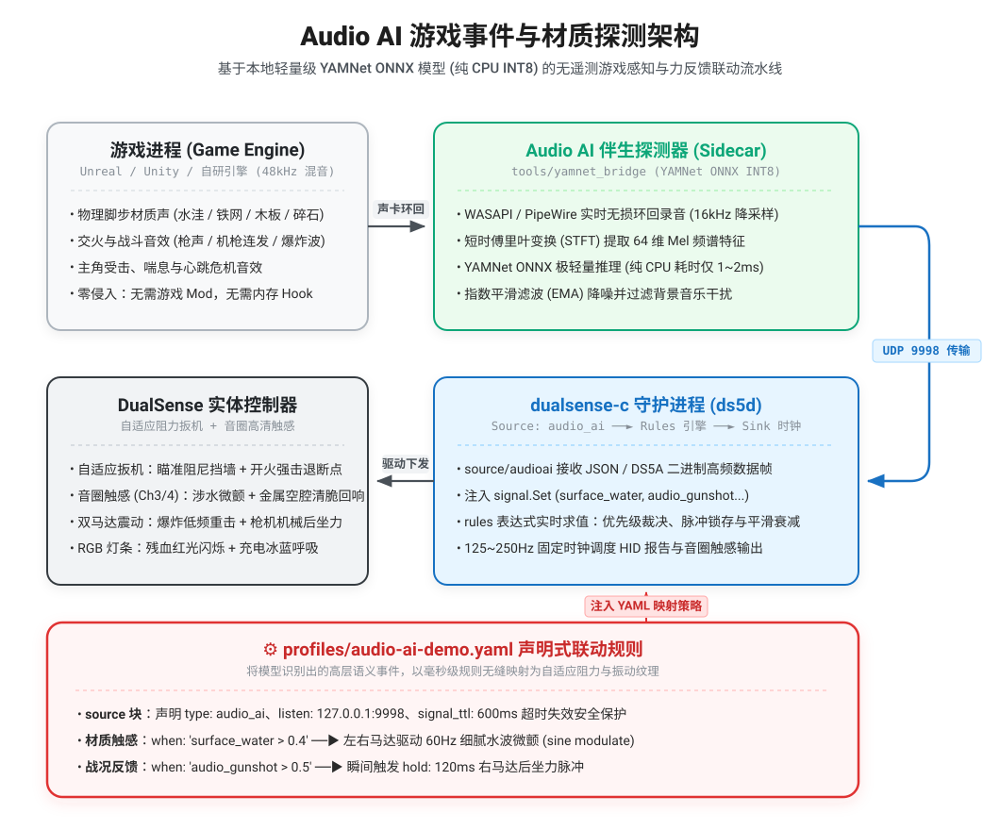

# 基于本地实时音频小模型的游戏事件与材质探测技术方案 (Audio AI Detector)

## 一、方案背景与核心价值

在现有的游戏外设驱动生态中，自适应扳机与力反馈的最大瓶颈在于**数据源缺失（Lack of Telemetry）**：
- **赛车模拟器**（Forza / Assetto Corsa）通常提供丰富的 UDP/共享内存物理量；
- **绝大多数 3A 动作与射击游戏**（如黑神话、艾尔登法环、COD、战地、赛博朋克 2077 等）完全不开放任何遥测接口。

然而，所有游戏都必须通过声卡输出音频。现代游戏引擎（Unreal Engine, Unity）与音频中间件（Wwise, FMOD）在底层早已建立严密的物理材质系统：**玩家踩在水洼、铁板、木桥或草地上时，引擎会自动混音对应材质的脚步声；开火、爆炸、破盾与受伤亦有特征鲜明的瞬态音效**。

**核心思想**：通过系统音频环回（WASAPI Loopback / PipeWire Monitor）低延迟截取游戏声音，借助本地运行的微型 AI 分类模型（如 Google YAMNet INT8，体积 < 3.8MB），在 **纯 CPU、零掉帧、1~2ms 推理** 的前提下，实时反向推断游戏内的物理材质与战斗事件，为 DualSense 控制器注入高维语义信号。

---

## 二、总体架构与数据链路

为了保持 `dualsense-c` 主守护进程 **纯 Go、零 CGO、跨平台纯净、高确定性** 的设计原则，本方案采用 **Sidecar（伴生探测器）架构**：

<p align="center">
  
</p>
<p align="center">
  <sub>（注：架构图源文件见 <a href="audio-ai-detector.excalidraw">audio-ai-detector.excalidraw</a>，支持在 <a href="https://excalidraw.com">Excalidraw</a> 中导入编辑）</sub>
</p>

---

## 三、模型选型与轻量化指标

选用开源的 **Google YAMNet (Yet Another MobileNet for Audio)** 作为基础模型：

| 指标项 | 规格与实测表现 | 说明 |
|---|---|---|
| **模型格式** | ONNX (INT8 量化) | 跨平台标准格式，支持 Windows DirectML / Linux CPU |
| **权重体积** | **~3.8 MB** (INT8 后约 **1.5 MB**) | 内存常驻占用极小，加载时间 < 100ms |
| **计算复杂度** | ~0.15 GFLOPs | 纯 CPU 单核心执行，CPU 占用率低于 0.8% |
| **推理延迟** | **1.5 ~ 2.5 ms** (单次窗口) | 极速收敛，远低于人类触觉延迟感知门槛 (30ms) |
| **显卡影响** | **0% GPU 占用 / 0MB 显存** | 绝不与游戏主进程争抢 Tensor Core 与显存带宽 |

### 目标声音事件映射表

YAMNet 内置 521 类 AudioSet 预训练标签，本项目将其聚焦映射为 7 个标准信号：

| 信号名称 | 对应 YAMNet 原始类别 | 触发场景与物理手感表现 |
|---|---|---|
| `surface_water` | `Water`, `Splash, splatter`, `Squish` | 涉水行走、踩水坑；触发低阻尼细密水花微颤 |
| `surface_metal` | `Metal`, `Clang`, `Ding` | 铁网、集装箱顶漫步；触发高频金属空腔共振触感 |
| `surface_wood` | `Wood`, `Cracking wood` | 木桥、木质地板；触发沉稳中频颗粒感 |
| `surface_gravel` | `Rubble`, `Crushed stone` (结合噪声包络) | 碎石路、沙地奔跑；触发宽频磨砂阻尼感 |
| `audio_gunshot` | `Gunshot, gunfire`, `Machine gun` | 开火瞬间；联动 R2 扳机释放机械后坐力脉冲 |
| `audio_explosion`| `Explosion`, `Artillery fire`, `Boom` | 爆炸波及；触发重度双马达低频下沉震动 |
| `audio_impact` | `Slam`, `Smash, crash`, `Thud` | 近战受击、钝器打击、高空坠落触底 |

---

## 四、信号注入与 Profile 规则范例

在 Profile 配置中声明 `source.type: audio_ai`，即可像使用常规物理遥测一样编写规则：

```yaml
name: action-adventure-ai
title: 动作冒险游戏通用 AI 材质与音效配置
description: |
  利用本地轻量音频小模型探测水洼、金属地面与开火音效，
  无缝驱动自适应扳机与力反馈。

source:
  type: audio_ai
  listen: "127.0.0.1:9998"   # 接收伴生探测器的数据流
  timeout: 500ms

rules:
  # 1. 涉水奔跑：当水花置信度超过阈值时，驱动震动马达输出细腻水花波
  - name: water-step-vibration
    when: 'has("surface_water") && surface_water > 0.45'
    target: rumble_left
    priority: 15
    value: "clamp(120 * surface_water, 40, 160)"
    modulate: { type: sine, hz: 60, depth: 0.8 }

  # 2. 踩在铁板/金属表面：驱动高频清脆共鸣感
  - name: metal-step-vibration
    when: 'has("surface_metal") && surface_metal > 0.5'
    target: rumble_right
    priority: 15
    value: "clamp(140 * surface_metal, 50, 180)"
    modulate: { type: square, hz: 180, depth: 0.9 }

  # 3. 枪声瞬态反馈：检测到枪声时，右马达瞬间给一记后坐力脉冲
  - name: audio-gunfire-recoil
    when: 'has("audio_gunshot") && audio_gunshot > 0.6'
    target: rumble_right
    priority: 40
    hold: 120ms
    value: "220"

  # 4. 基础瞄准与射击挡墙（结合控制器硬件物理输入，保证 < 5ms 零延迟）
  - name: aim-wall
    when: "l2 < 0.5"
    target: l2
    effect: feedback
    priority: 10
    params: { start: "0", strength: "4", force: "160" }

  - name: aim-release
    when: "l2 >= 0.5"
    target: l2
    effect: off
    priority: 20
```

---

## 五、端到端延迟预算（< 25ms）

人脑对“声音/画面”与“指尖触觉”的因果同步容忍度约为 **40 ~ 60ms**。本方案全链路控制在 **25ms 以内**：

1. **声卡环回抓取缓冲**：`10 ms`（PipeWire / WASAPI 环回块）；
2. **STFT 预处理**：`1 ~ 2 ms`；
3. **ONNX INT8 推理**：`1.5 ~ 2 ms`；
4. **本机 UDP 传输**：`< 0.5 ms`；
5. **dualsense-c 规则求值与 HID 下发**：`4 ~ 8 ms`（125~250Hz 输出时钟）。
- **总端到端延迟**：约 **18 ~ 24 ms**，完全处于“音触同频”的自然感知区间内。

---

## 六、最佳实践与使用建议

1. **游戏内音频设置优化**：
   大部分游戏支持在音频设置中独立调整通道：
   - 建议将 **主音量 / 效果音（SFX）** 设为 `100%`；
   - 适当将 **背景音乐（BGM）** 调整至 `40% ~ 50%`，可显著减少交响乐混响对脚步声与枪声分类器的干扰。
2. **输入分工原则**：
   - **扳机机械挡墙**：必须由手柄本身的 `trigger` 模拟行程驱动（保证手指搭上去的第 3 毫秒即感知阻力）；
   - **环境材质与战况反馈**：由 `audio_ai` 信号驱动，实现丰富细节扩展。
