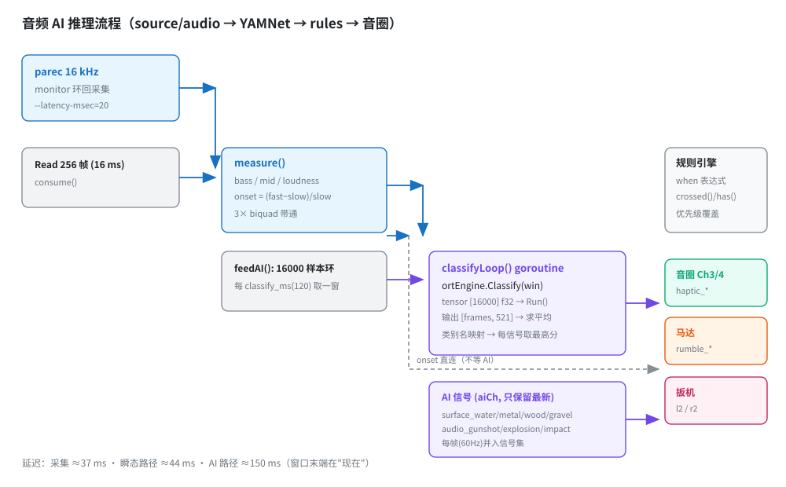
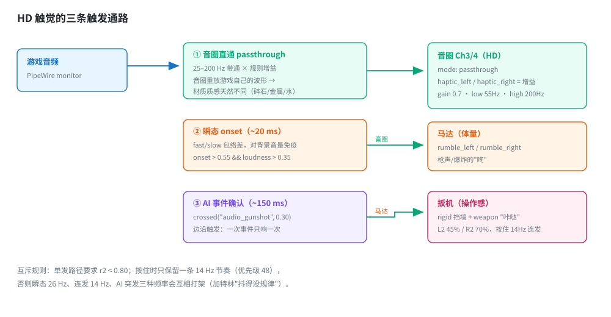

# 音频 AI 接入与 HD 触感：使用、推理流程与调优

本文说明三件事：

1. **怎么用** —— 构建、模型、跑起来的完整步骤
2. **推理怎么跑** —— 从 PCM 到信号，每一步在哪个文件、哪个 goroutine
3. **HD 震动是怎么触发的** —— 音圈直通、瞬态检测、事件确认三条通路各自负责什么

配套的通用设计（音圈硬件、力反馈镜像）见
[audio-haptics-and-ffb.md](audio-haptics-and-ffb.md)。

---

## 目录

- [一、它解决什么问题](#一它解决什么问题)
- [二、快速开始](#二快速开始)
- [三、推理流程](#三推理流程)（含流程图）
- [四、HD 震动是怎么触发的](#四hd-震动是怎么触发的)（含通路图）
- [五、可用信号](#五可用信号)
- [六、参数一览](#六参数一览)
- [七、标定与调试](#七标定与调试)
- [八、延迟预算](#八延迟预算)
- [九、调优速查](#九调优速查)
- [十、Windows 说明](#十windows-说明)

---

## 一、它解决什么问题

大多数游戏不会把"踩在碎石上""刚开了一枪"这类信息告诉外部程序。音频里其实全都有，
但需要识别：

| 输入 | 输出 |
|---|---|
| 系统正在播放的声音 | `surface_water/metal/wood/gravel`（材质置信度） |
| | `audio_gunshot/explosion/impact`（事件置信度） |

有了这些信号，规则引擎就能驱动**音圈（HD 细节）**与**马达（体量）**。

模型用 YAMNet（AudioSet 521 类，约 16 MB），通过 **ONNX Runtime C API** 在进程内运行
——不需要 Python，默认构建也不引入 cgo（AI 是 `-tags onnx` 的可选能力）。

---

## 二、快速开始

### 1. 依赖

```bash
# ONNX Runtime（官方仓库包，提供 libonnxruntime.so + 头文件）
sudo pacman -S onnxruntime-cpu        # Debian/Ubuntu: apt install libonnxruntime-dev
```

`parec` / `pacat` / `pactl`（PipeWire 或 PulseAudio 工具链）用于音频采集与播放。

### 2. 模型（约 16 MB，不入库）

```bash
mkdir -p models
curl -L -o models/yamnet.onnx \
  https://huggingface.co/niobures/YAMNet/resolve/main/yamnetonnx/yamnet.onnx
curl -L -o models/yamnet_class_map.csv \
  https://huggingface.co/niobures/YAMNet/resolve/main/yamnetonnx/yamnet_class_map.csv
```

`models/` 已在 `.gitignore` 中。

### 3. 构建

```bash
make build-onnx          # → bin/ds5d-onnx（CGO + -tags onnx）
make build               # 普通版本，AI 返回 ErrUnsupported，其余功能不变
```

### 4. 运行

```bash
./bin/ds5d-onnx -profiles ./profiles -profile far-far-west-hd -rate 125 -trace
```

两个可直接参考的 profile：

| profile | 用途 |
|---|---|
| `profiles/far-far-west-hd.yaml` | 射击游戏：音圈直通 HD + 自适应扳机 + 事件冲击 |
| `profiles/audio-ai-yamnet.yaml` | 通用：材质与事件的马达/音圈映射，含扳机挡墙 |

---

## 三、推理流程

<p align="center">
  
</p>

### 3.1 生命周期

```
ds5d 启动
 └─ profile.source.type = combo
      └─ parts[1] = { type: audio, model: models/yamnet.onnx }
           └─ audio.New()
                ├─ audioai.Open(model, classMap, threads)
                │    ├─ LoadClassMap()                 读 CSV → 索引→类名
                │    └─ openEngine()                   ← build tag: onnx
                │         ├─ OrtGetApiBase()->GetApi(ORT_API_VERSION)
                │         ├─ CreateEnv / CreateCpuMemoryInfo
                │         ├─ CreateSessionOptions + SetIntraOpNumThreads
                │         ├─ CreateSession(model.onnx)
                │         └─ SessionGetInputName / SessionGetOutputName（各一次）
                └─ go classifyLoop(ctx)                ← 独立 goroutine
```

引擎只创建一次，会话常驻内存；`Close()` 在 ctx 结束时释放。

### 3.2 每次推理

```
parec --rate=16000 --latency-msec=20 --process-time-msec=2
  │  f32le PCM
  ▼
consume()                    每 Read 得到 256 帧（16 ms）
  ├─ measure(samples)         计算 bass/mid/loudness/onset（见第四节）
  └─ feedAI(samples)          追加到 16000 样本环形缓冲
        └─ 每 classify_ms(默认 120ms) 拷贝最近 16000 样本
             → winCh（容量 2，满了直接丢弃，绝不阻塞采集）
  ▼
classifyLoop()（goroutine）
  └─ clf.Signals(win)
       ├─ ortEngine.Classify(win)
       │    ├─ CreateTensorWithDataAsOrtValue  shape=[16000] float32
       │    ├─ Run()
       │    ├─ GetTensorTypeAndShape → [frames, 521]
       │    └─ 按帧求平均 → 521 个类别分数
       └─ 名称映射（按 display name，不按索引）
            每个信号 = 其匹配类别中的最高分
       └─ 结果写入 aiCh（容量 4，只保留最新）
  ▼
规则引擎（125 Hz 输出 / 60 Hz 信号）
  └─ 每帧把 aiCh 的最新结果并入信号 → when 表达式求值
```

**为什么窗口末端是"现在"**：窗口取的是最近 1 秒，事件发生后它立即落在窗口里，
所以 AI 的延迟是 `hop(120ms) + 推理(~5ms)`，而不是等满 1 秒。

### 3.3 类别映射

映射写在 `internal/audioai/engine.go` 的 `SignalLabels`，按 AudioSet **显示名**匹配：

```go
"surface_metal":  {"Clang", "Slam", "Bang", "Metal", "Steel", "Hiss"}
"audio_gunshot":  {"Gunshot, gunfire", "Machine gun", "Cap gun", "Artillery fire"}
"audio_explosion":{"Explosion", "Boom", "Eruption", "Smash, crash"}
```

用名字而不是索引，是因为不同导出/版本的索引会漂移。

---

## 四、HD 震动是怎么触发的

HD 触感的载体是**音圈**（USB 声卡 Ch3/4）。触发它有三条通路，分工明确：

<p align="center">
  
</p>

### ① 音圈直通：连续的"材质纹理"

```yaml
haptics:
  mode: passthrough
  low_hz: 55          # 下限：越低越"沉"，但脚步/引擎也在这里
  high_hz: 200        # 上限：碎石/金属的"脆"
  gain: 0.7           # 通带总增益
```

`passthrough` 会自己抓一份 monitor，滤波后写 Ch3/4 —— **音圈重放的是游戏自己的波形**，
所以不同地面的质感天然不同。规则里的 `haptic_left/right` 在这时是**增益**：

```yaml
- name: gravel-coil
  when: 'surface_gravel > 0.20 && surface_gravel >= surface_water && ...'
  target: haptic_left
  value: "clamp(80 + 270 * surface_gravel, 0, 180)"   # 0..255 → 0..70% 送进音圈
```

> ⚠️ **经验**：常驻底纹（哪怕 18/255）在脚步频繁的游戏里会显得"一直震"。
> 当前 profile 刻意没有常驻增益，只在识别出材质或事件时出力。

### ② 瞬态 `onset`：为什么不能用绝对音量

游戏里音乐会把整体响度顶到饱和（实测 `loudness` 的 p90 = 1.000），所以
"loudness > 阈值"要么一直成立、要么永不成立，两个方向都错。

```go
// source/audio：fast/slow 双跟踪器
fast += 0.6 * (rms - fast)    // 上升快
fast += 0.15 * (rms - fast)   // 下降慢
slow += 0.05 * (rms - slow)   // ~300ms 背景床
onset = clamp((fast - slow) / (slow + 0.002), 0, 1)
```

实测：

| 场景 | onset |
|---|---|
| 静音 | 0.000 |
| 稳定音乐床 | 0.110 |
| 枪声（安静时） | 1.000 |
| **音乐床上叠加枪声** | **0.540** |

规则里用 `onset > 0.55 && loudness > 0.35` 判定"真的是一记响动"，
再叠加 `r2 < 0.80` 与连发路径互斥：

```yaml
- name: transient-motor
  when: 'has("onset") && onset > 0.55 && loudness > 0.35 && r2 < 0.80'
  hold: 85ms
```

### ③ AI 事件确认：更准但更慢

YAMNet 能区分「枪声 / 爆炸 / 命中」，这是包络做不到的。但它有 ~150 ms 延迟，
且 1 秒窗口会让分数在门槛之上停留多帧 —— 所以用**边沿触发**，一次事件只响一次：

```yaml
- name: gunshot-motor
  when: 'crossed("audio_gunshot", 0.30) && r2 < 0.80'
  hold: 90ms
```

### 三条通路的优先级

| 优先级 | 规则 | 作用 |
|---|---|---|
| 65 | `explosion-*` | 爆炸最强，压过一切 |
| 55 | `gunshot-*` | AI 确认的枪声 |
| 48 | `auto-fire-*` | 按住时的唯一节奏（14Hz 方波） |
| 45 | `transient-*` | 单发起音（onset） |
| 10/20 | `l2-*` `r2-*` | 扳机挡墙（不同 target，互不冲突） |

同一 `target` 上高优先级**整组覆盖**低优先级，所以连发时只留 14Hz 一条节奏，
不会出现多条频率打架（这正是"加特林抖动无规律"的原因）。

---

## 五、可用信号

| 信号 | 来源 | 范围 | 说明 |
|---|---|---|---|
| `bass` | audio | 0..1 | 20–110 Hz 包络 |
| `mid` | audio | 0..1 | 160–450 Hz 包络 |
| `loudness` | audio | 0..1 | 全带包络 |
| **`onset`** | audio | 0..1 | 瞬态检测，对绝对音量免疫 |
| `surface_water` | YAMNet | 0..1 | 水面/水花 |
| `surface_metal` | YAMNet | 0..1 | 金属/铁板 |
| `surface_wood` | YAMNet | 0..1 | 木板 |
| `surface_gravel` | YAMNet | 0..1 | 碎石/沙地 |
| `audio_gunshot` | YAMNet | 0..1 | 枪声/连发/炮击 |
| `audio_explosion` | YAMNet | 0..1 | 爆炸 |
| `audio_impact` | YAMNet | 0..1 | 撞击/重击 |

---

## 六、参数一览

### `source.audio`（AI 相关）

| 参数 | 默认 | 说明 |
|---|---|---|
| `model` | 空 | ONNX 模型路径；非空即启用推理 |
| `class_map` | `models/yamnet_class_map.csv` | 类别表 |
| `classify_ms` | 250 | 推理间隔（下限 100）。窗口固定 1s，只影响更新率 |
| `threads` | 2 | ONNX Runtime 线程数 |
| `rate` | 24000 | 启用模型后**必须** 16000（YAMNet 输入） |
| `gain` | 2.5 | 包络线性增益（生效于归一化后） |
| `attack_ms` / `release_ms` | 4 / 90 | 包络跟随速度 |
| `bass_hz` / `mid_hz` | `20,110` / `160,450` | 频段边界 |
| `ai_debug` | false | 每 `classify_ms` 打印 top-3 类别 |
| `env_debug` | false | 每秒打印 `raw/rms/bass/mid/loudness/onset` 峰值 + 毫秒级 onset 时间戳 |

### `haptics`

| 参数 | 默认 | 说明 |
|---|---|---|
| `mode` | `synth` | `synth`=合成载波；`passthrough`=**游戏音频直通（HD）** |
| `low_hz` / `high_hz` | 25 / 180 | passthrough 通带 |
| `gain` | 0.55 | 总输出增益 |
| `carrier_hz` | 55 | synth 模式的基频 |
| `source` | auto | passthrough 采集的 monitor |
| `command` | pacat … | 播放命令模板 |

---

## 七、标定与调试

**先看信号，再调门槛** —— 这是整个特性里最重要的经验：之前的多次误判（门槛过高、
gain 不生效、延迟归因错误）都是靠日志定位的。

```yaml
source:
  parts:
    - type: audio
      model: models/yamnet.onnx
      ai_debug: true      # 每 120ms：audio: ai Explosion=0.52 Gunshot=0.48 ...
      env_debug: true     # 每秒：audio: env peak raw=… onset=… + 毫秒级 onset 时间戳
```

典型日志：

```
audio: ai Gunshot, gunfire=0.50 Explosion=0.49 Fusillade=0.42
audio: env peak raw=0.487 rms=0.1416 bass=0.020 mid=0.022 loudness=0.376 onset=1.000
audio: onset loudness=1.000 at=00:12:22.840
```

调参流程：

1. 开 `env_debug`，进游戏跑 1 分钟
2. 看 `onset` 的峰值分布：正常开枪应到 0.5–1.0，走路应低于 0.4
3. 看 `ai_debug` 里事件的**实际类名与分数**，据此设 `crossed(..., 0.3)` 的门槛
4. 看材质四者的分数排序，决定是否需要"四者最高分"约束

---

## 八、延迟预算

| 环节 | 实测 |
|---|---|
| `parec` 采集（扣掉播放器启动） | **37 ms** |
| 包络 + 瞬态检测（256 帧块） | ~16 ms |
| 规则求值 → HID 输出 | 8 ms |
| 音圈 PCM 写入 → 声卡 | ~20–40 ms |
| **瞬态路径合计** | **≈ 44 ms**（含播放器启动 ~25 ms） |
| AI 路径（`classify_ms` 120） | **~150 ms** |

> 若整体感觉慢，先确认 `parec`/`pacat` 命令里带了
> `--latency-msec=20 --process-time-msec=2`。早期这两个参数没生效时，
> 整条流晚了约 1.5 秒，而 AI 会被误判成"很慢"。

---

## 九、调优速查

| 现象 | 改哪里 |
|---|---|
| 走路一直震 | 删掉常驻 `haptic_*` 增益规则；`low_hz` 抬到 55–70 |
| 单发拖尾太长 | AI 事件用 `crossed()`；`hold` 降到 80–90ms |
| 连发抖动无规律 | 按住路径与其他路径互斥（`&& r2 < 0.80`），只留一条节奏 |
| 开枪没反应 | 开 `env_debug` 看 `onset` 是否 >0.5；不够就降门槛到 0.45 |
| 爆炸不够猛 | `explosion-*` 的 `hold` 加长；音圈 255 |
| 材质识别太灵敏 | 门槛 0.20 → 0.35，并保留"四者最高分"约束 |
| 音圈太闷 / 太脆 | `low_hz` 55↔35；`high_hz` 200↔260 |
| CPU 占用高 | `classify_ms` 120 → 200；`threads` 4 → 2 |

---

## 十、Windows 说明

AI 引擎的代码本身是平台无关的（`engine_onnx.go` 同时服务 Linux/Windows），
Windows 适配需要三块：

| 项 | Linux 实现 | Windows 实现 |
|---|---|---|
| ONNX Runtime 链接 | `make build-onnx`（`-lonnxruntime`） | `make build-windows-onnx`（支持 `ORT_WIN_DIR` / `MINGW_CC` 与 `_WIN32` 宽字符路径） |
| 音频采集 | `parec`（PipeWire monitor） | 原生 WASAPI Loopback（`internal/wasapi`，纯 Go COM） |
| 音圈输出 | `pacat`（4 声道 sink） | 原生 WASAPI 4 声道渲染（`internal/wasapi`，`SPEAKER_QUAD` `0x33`） |

**零改动方案**：Windows 上可以让探测器作为独立进程，通过 UDP 发给
`source/audio_ai`：

```
探测器（任意语言） → UDP 127.0.0.1:9998 → ds5d.exe
```

`source/audio_ai` 的线协议平台无关，`-tags onnx` 只是"省一个进程"的优化。
