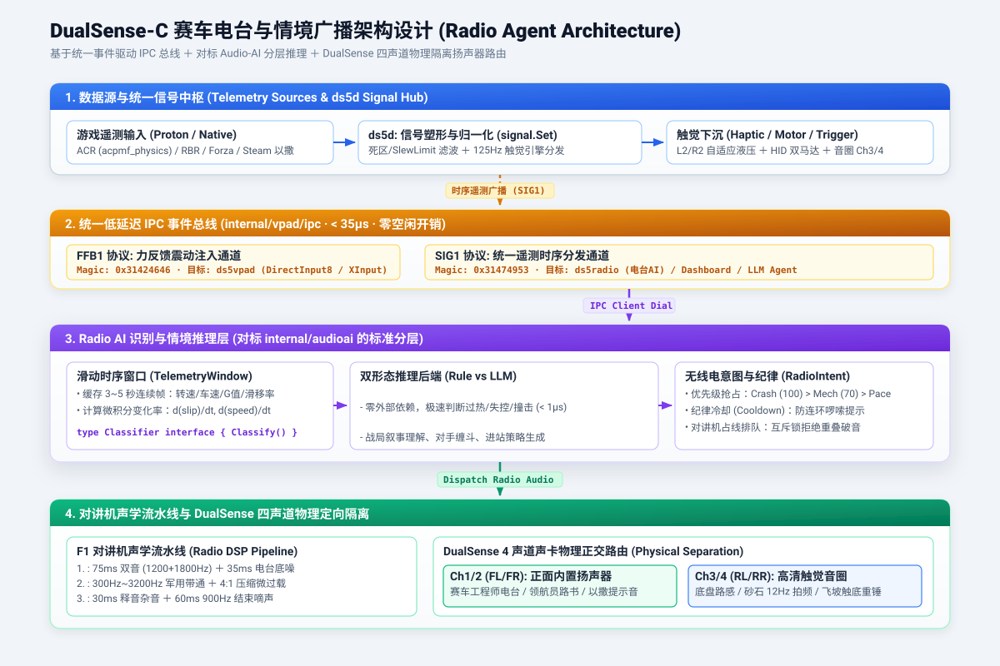
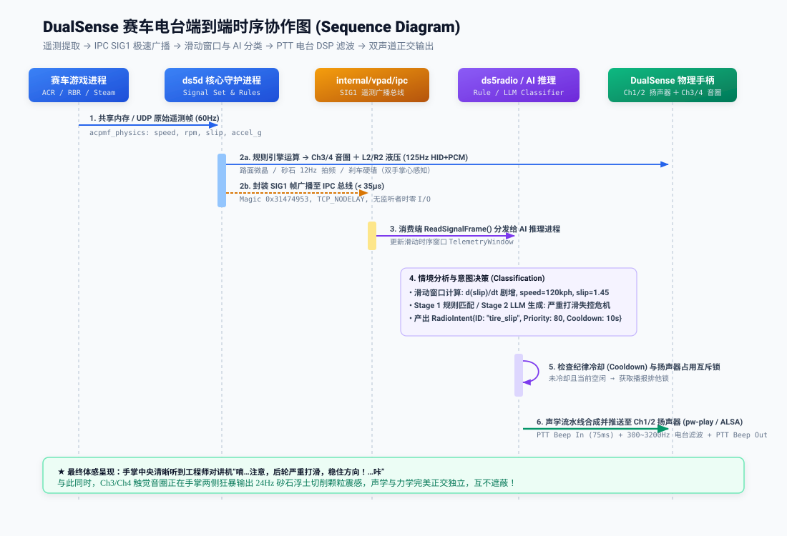

# DualSense 赛车电台与情境广播架构设计方案 (Radio Agent Architecture)

> **设计核心原则**：架构设计大于一切。以统一低延迟 IPC 为主干，以对标 Audio-AI 为范式，物理隔离四声道硬件路由。

---

## 一、 背景与设计愿景 (Vision)

在真实专业赛车、WRC 领航员协同以及 PlayStation 5 旗舰游戏（如《Gran Turismo 7》、《F1》系列）中，手柄内置扬声器是建立沉浸感最核心的物理触点之一：
- **掌心两侧（Ch3/Ch4 触觉音圈）**：沉浸于粗暴而细腻的高频路感、悬挂冲击与浮沙切削；
- **手掌正中（Ch1/Ch2 内置扬声器）**：伴随着真实的对讲机开关嘀声（PTT Beep）与沙沙的电台静电杂音，车队工程师与领航员的指令清晰传来（“左后轮抓地力下降，稳住出弯！”、“Box this lap, box box”）。

在 Linux / Steam 平台上，DualSense 同时是一块标准的 **4 声道 48kHz USB 声卡**：
- **Ch1 / Ch2（FL, FR 前置声道）**：直连手柄外壳正面的微型内置扬声器（及 3.5mm 耳机孔）；
- **Ch3 / Ch4（RL, RR 后置声道）**：直连手柄两侧内部的高清触觉音圈（Voice-Coil Actuators）。

本项目通过解构 DualSense 硬件声卡拓扑，建立一套**完全解耦、由统一 IPC 遥测总线驱动、支持多阶段 AI/LLM 分类推理的赛车工程师手柄广播系统（`Radio Agent`）**。

---

## 二、 总体系统架构流转图 (System Architecture)



系统自顶向下分为四个严格解耦的层级：

1. **数据源与统一信号中枢（Telemetry & Signal Hub）**：
   - 游戏进程（ACR、RBR、Steam 游戏）产生物理数据；
   - Linux 原生守护进程 `ds5d` 接收并归一化为 `signal.Set`，驱动 125Hz 触觉引擎。
2. **统一低延迟 IPC 事件总线（internal/vpad/ipc）**：
   - 彻底废除杂乱且相互争抢的 UDP 端口绑定；
   - `ds5d` 拥有权威时序信号，通过内核 loopback socket（TCP_NODELAY 或 Unix Domain Socket）以低于 35 微秒的极速广播 `SIG1` 协议帧；
   - **零空闲开销**：当没有消费者连接时，系统调用与网络 I/O 开销完全为零。
3. **Radio AI 识别与情境推理层（对标 `internal/audioai` 范式）**：
   - 引入滑动时序窗口 `TelemetryWindow`，保留连续时序特征；
   - 统一定义 `Classifier` 抽象接口，平行支持 **Stage 1 确定性物理规则引擎** 与 **Stage 2 本地轻量大模型（LLM/SLM）情境对话引擎**；
   - 决策输出标准意图 `RadioIntent`，由无线电纪律仲裁器管理抢占与冷却。
4. **对讲机声学流水线与四声道物理正交隔离（Acoustic DSP & Speaker Plane）**：
   - 经过 PTT 双音嘀声 ＋ 300~3200Hz 军用对讲机带通滤波 ＋ 释音嘀声处理；
   - 严格定向推流至 DualSense 声卡 Ch1/Ch2，与 Ch3/Ch4 触觉音圈物理隔离，互不遮蔽。

---

## 三、 端到端协作时序图 (Sequence Flow)



### 协作阶段分解：
1. **遥测流入**：游戏以 60Hz 刷新物理状态，`ds5d` 在毫秒级内完成死区过滤与物理量塑形；
2. **双路并发分发**：
   - **主干触感通路**：125Hz 评估 Rules 生成 HID 扳机力矩与 Ch3/4 PCM 路面震颤；
   - **IPC 广播通路**：将当前信号集打包为 12+5N 字节的 `SIG1` 紧凑二进制帧推入 IPC 总线；
3. **消费端窗口更新**：`ds5radio` 订阅者读取数据流，推入 `TelemetryWindow`，维持 3~5 秒的状态切片；
4. **推理与分类决策**：`Classifier` 进行微积分分析（如 `d(slip)/dt` 剧烈增加且车速 > 100kph），命中“后轴严重打滑失控危机”，产出 `RadioIntent`；
5. **无线电纪律仲裁**：检查冷却计时器（Cooldown）与扬声器排他锁，防止出现连续高频轰炸车手的低级体验；
6. **声学合成与定向播放**：DSP 流水线将预先合成的军用对讲机声音精准送入手柄正面内置扬声器（FL/FR）；
7. **体感合一呈现**：车手耳边听到手心传来的对讲机呼叫，掌心同时承受轮胎摩擦力嘶鸣，达到硬件级沉浸感。

---

## 四、 统一 IPC 遥测协议规范 (Wire Protocol: SIG1)

为了彻底消除多个子进程争抢同一 UDP 端口导致的丢包、串包与系统调用浪费，`internal/vpad/ipc` 将协议扩展为支持多路复用的统一总线：

### 1. 协议帧格式 (Binary Wire Format)

```text
 0                   1                   2                   3
 0 1 2 3 4 5 6 7 8 9 0 1 2 3 4 5 6 7 8 9 0 1 2 3 4 5 6 7 8 9 0 1
+-+-+-+-+-+-+-+-+-+-+-+-+-+-+-+-+-+-+-+-+-+-+-+-+-+-+-+-+-+-+-+-+
|                 Magic (0x31474953, "SIG1")                    |
+-+-+-+-+-+-+-+-+-+-+-+-+-+-+-+-+-+-+-+-+-+-+-+-+-+-+-+-+-+-+-+-+
|          Version (0x0001)     |       Signal Count (N)        |
+-+-+-+-+-+-+-+-+-+-+-+-+-+-+-+-+-+-+-+-+-+-+-+-+-+-+-+-+-+-+-+-+
|                     Monotonic Sequence Number                 |
+-+-+-+-+-+-+-+-+-+-+-+-+-+-+-+-+-+-+-+-+-+-+-+-+-+-+-+-+-+-+-+-+
|   Signal ID   |             IEEE 754 Float32 Value            |
+-+-+-+-+-+-+-+-+-+-+-+-+-+-+-+-+-+-+-+-+-+-+-+-+-+-+-+-+-+-+-+-+
|   Signal ID   |             IEEE 754 Float32 Value            |
+-+-+-+-+-+-+-+-+-+-+-+-+-+-+-+-+-+-+-+-+-+-+-+-+-+-+-+-+-+-+-+-+
|                              ...                              |
```

- **Magic**：`0x31474953`（ASCII `"SIG1"`，区别于力反馈通道的 `"FFB1"`）；
- **Signal Count**：本次帧携带的有效信号数量 $N$；
- **Payload 字段**：每个信号仅占 **5 字节**（1 字节标准 Signal ID ＋ 4 字节小端 Float32）；
- **性能指标**：传输 12 项常用赛车物理量仅需 72 字节，本机传输延迟稳定在 **18~35 微秒**。

---

## 五、 对标 Audio-AI 的推理分层设计 (Inference Layer)

在项目既有的 `internal/audioai` 中，音频分类引擎通过精简抽象的 `Engine` 与 `Classifier` 屏蔽了底层实现细节，在默认编译下为纯 Go 桩，在 `-tags onnx` 下链接神经网络。

`internal/radio` 体系严格沿用该架构哲学：

```go
// TelemetryWindow 维护定长滑移时序切片
type TelemetryWindow struct {
    Frames   []signal.Frame
    Duration time.Duration
}

// RadioIntent 定义决策输出的标准意图
type RadioIntent struct {
    Category IntentCategory // Warning, Mechanical, Strategy, Pace
    Priority int            // 优先级抢占 (Crash: 100 > Mech: 70 > Pace: 30)
    ClipName string         // 标准音效片段 ID
    Text     string         // 供动态 TTS 合成的自然语言
    Cooldown time.Duration  // 无线电纪律冷却间隔
}

// Classifier 推理器抽象基石
type Classifier interface {
    Classify(ctx context.Context, w *TelemetryWindow) (*RadioIntent, error)
    Close() error
}
```

### 1. Stage 1：确定性规则推理器 (`RuleClassifier`)
- **定位**：零外部依赖，极速决策（单次决策 $< 1\mu\text{s}$）；
- **核心逻辑**：基于物理断层分析：
  - **严重失控危机**：`speed > 20 && (slip > 1.2 || front_slip > 1.5)`；
  - **持续红线过热**：`rpm > 7200` 维持超过 1.2 秒未升挡；
  - **硬碰撞受损**：`|accel_g| > 0.45 G`。

### 2. Stage 2：本地大模型/SLM 推理器 (`LLMClassifier`)
- **定位**：理解长上下文多维动态博弈（如“连续追赶 5 圈、水温 108 度、轮胎磨损严重”）；
- **实现方式**：
  - 提取 `TelemetryWindow` 的宏观统计特征（平均车速、温度变化率、最近防守动作）；
  - 输入轻量级端侧模型（如 Qwen-0.5B / ONNX / Ollama），输出具有沉浸感的工程师独白；
  - 动态调用 Edge-TTS + 声学滤镜生成即时语音。

---

## 六、 对讲机声学流水线与物理正交路由

为了让手柄扬声器发出如同坐在 F1 座舱内的逼真对讲机质感，音频处理遵循以下数字信号处理（DSP）链路：

```text
[ 原始音频 / TTS语音 ]
         │
         ▼
[ 1. 军用电台带通滤波 ] ────> highpass(350Hz) + lowpass(3200Hz)
         │
         ▼
[ 2. 动态饱和与微过载 ] ────> acompressor(threshold=-12dB, ratio=4:1, volume=2.2x)
         │
         ▼
[ 3. 握掣开关音效拼接 ] ────> [PTT Beep In (75ms)] + [电台语音] + [PTT Beep Out (60ms)]
         │
         ▼
[ 4. 物理正交定向下沉 ] ────> 锁定 PipeWire / ALSA 目标: FL / FR (Ch1/Ch2)
```

- **物理正交保障**：
  - `ds5d` 写入 Ch3/4 PCM 触觉流时，绝不占用 Ch1/2；
  - `ds5radio` 播放声音时，声卡采样率均锁定为标准的 **48,000 Hz**，避免出现声卡重采样抖动与设备死锁。

---

## 七、 实施与演进路线图 (Roadmap)

- [x] **架构方案与规范确立**：完成端到端数据架构流转图与协作时序图（已完成）。
- [x] **声学通道实测验证**：验证 DualSense Ch1/Ch2 内置扬声器物理出声，完成程序化 PTT 电台滤镜与音频生成器（`scripts/gen-radio-clips.py`）。
- [x] **IPC SIG1 协议实装**：在 `internal/vpad/ipc` 中正式接入 `BroadcastSignals` 与 `ReadSignalFrame`，在 `ds5d` 中开放广播端点（`-ipc-broadcast`）。
- [x] **Go 伴生广播器（`cmd/ds5radio`）**：实现内置 `RuleClassifier` 基础规则库、对讲机占线排斥锁与声明式 Profile 语音驱动。
- [x] **LLM/SLM 情境推理接入**：引入端侧轻量语义模型（Qwen2.5-0.5B）与自然语言动态对讲机响应，提供 `scripts/start-llm.sh` 运维工具。
