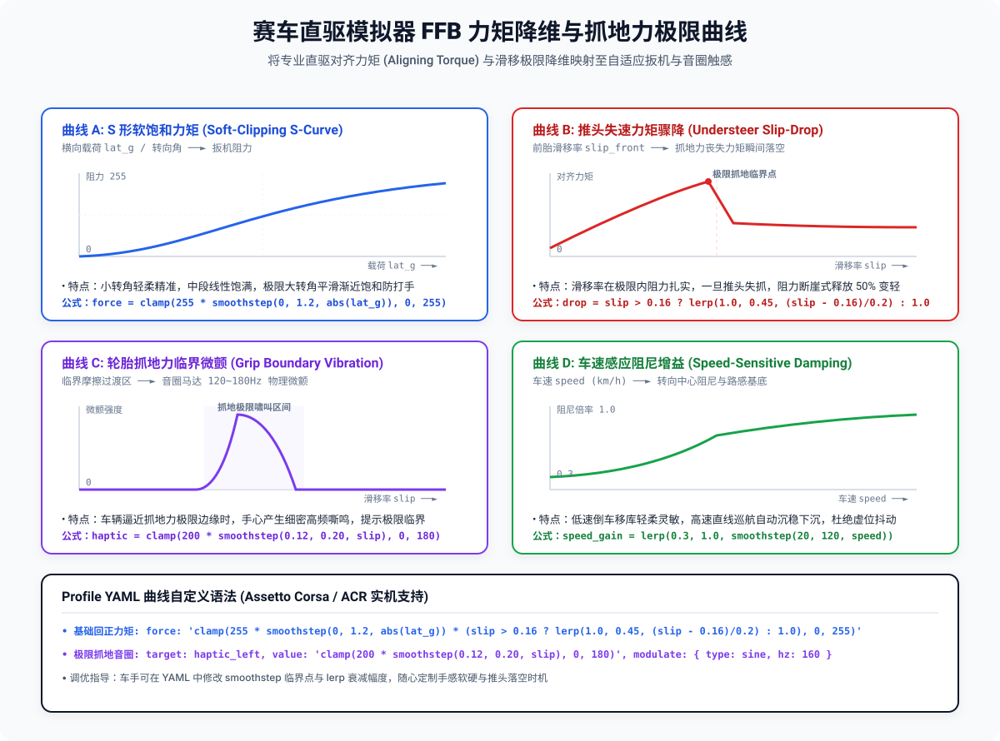

# 赛车直驱模拟器 FFB 力矩降维与抓地力极限（AC / ACC / ACR）

在真实的赛车运动与万元级直驱方向盘（Direct Drive Wheel）模拟器中，车手感知车辆极限最核心的依据是**前轮对齐力矩（Aligning Torque）**与**轮胎滑移附着力边界（Grip Boundary）**。

传统游戏手柄只有粗糙的单频马达震动，无法表达方向盘由沉变轻的推头物理现象。
本项目通过提取 Assetto Corsa / ACC / AC Rally 的物理遥测（`acpmf_physics` 共享内存中的 `lat_g`、`steer`、`slip_fl/fr`），将其降维映射为 **自适应扳机阻尼** 与 **音圈马达高频嘶鸣微颤**。

---

## 核心映射曲线图

<p align="center">
  
</p>
<p align="center">
  <sub>（注：架构图源文件见 <a href="https://github.com/npc1607/dualsense-c/blob/main/docs/direct-drive-curves.excalidraw">docs/direct-drive-curves.excalidraw</a>，支持在 <a href="https://excalidraw.com">Excalidraw</a> 中导入编辑）</sub>
</p>

---

## 四大常用直驱映射曲线详解

### 1. 曲线 A：S 形软饱和力矩 (Soft-Clipping S-Curve)
- **输入物理量**：转弯横向加速度 G 值（`absf(lat_g)`）与方向盘转角（`steer`）；
- **输出执行端**：自适应扳机阻力（`0..255`）；
- **手感特征**：
  - 小转向角时轻柔精准，转向中心虚位过渡平滑；
  - 中度过弯时阻力随侧向 G 值线性充盈加重，呈现扎实的轮胎载荷；
  - 逼近大转向角与颠簸尖峰时平滑软饱和（Soft-Clipping），防止机械步进马达强行打手或过热。
- **配置语法**：`force = clamp(255 * smoothstep(0, 1.2, absf(lat_g)), 0, 255)`

### 2. 曲线 B：推头失速力矩骤降 (Understeer Slip-Drop)
- **输入物理量**：前胎滑移率（`max(slip_fl, slip_fr)`）；
- **输出执行端**：转向阻尼与手部阻力感知；
- **手感特征**：
  - 在轮胎最佳附着力区间（滑移量 < 0.8），转向阻力坚挺饱满；
  - **一旦前轮突破摩擦圆发生推头失控（Understeer，滑移量超过阈值）**，阻力瞬间断崖式跌落 40%~60%，方向盘/扳机手感瞬间“落空变轻”；
  - 忠实还原真实赛车推头时前轮失去附着力、回正力矩骤降的物理体感！
- **配置语法**：`drop = slip > 1.4 ? lerp(1.0, 0.45, (slip - 1.4)/1.5) : 1.0`

### 3. 曲线 C：轮胎抓地力临界音圈高频微颤 (Grip Boundary Vibration)
- **输入物理量**：前轮摩擦力极限过渡区（`lat_g > 0.35` 且 `slip` 处于 0.35~1.4 临界边缘）；
- **输出执行端**：USB 4 声道音圈致动器（`haptic_left` / `haptic_right`，160Hz 正弦波）；
- **手感特征**：
  - 当车辆逼近抓地力极限边缘时，手心产生极为细密的 160Hz 物理微颤；
  - 车手无需看仪表，仅凭手心触感即可感知“轮胎橡胶块正在被撕扯摩擦，濒临失控边缘”。
- **配置语法**：`target: haptic_left, value: clamp(210 * smoothstep(0.35, 0.85, max(slip_fl, slip_fr)), 0, 200), modulate: { type: sine, hz: 160 }`

### 4. 曲线 D：车速感应阻尼增益 (Speed-Sensitive Damping)
- **输入物理量**：车速 `speed` (km/h)；
- **输出执行端**：转向中心基础阻尼基底；
- **手感特征**：低速移库倒车轻盈柔和，高速直线巡航自动下沉变重，彻底消除高速行驶时的中心虚位微晃。

---

## 规则引擎自定义曲线函数

规则引擎原生内置了两个高级非线性函数，车手无需改动 Go 代码即可自由定义曲线：

| 函数签名 | 说明与用法 |
|---|---|
| `curve(x, x0, y0, x1, y1, ...)` | **多点折线/曲线查表插值**：车手可随意给定多个控制点坐标，自动线性拟合。例如 `curve(brake, 0, 18, 0.08, 45, 0.65, 180, 1.0, 255)` 自定义初段轻柔、中段饱满、末段急剧抗拒的脚刹曲线。 |
| `scurve(x, power)` | **软饱和 S 曲线函数**（输入 `[0, 1]`）：小转角轻柔，中段线性，极限大转角渐进软饱和，消除机械冲击。 |

---

## 今晚 ACR（Assetto Corsa Rally）实战测试指引

1. **启动守护进程**：
   ```bash
   ./bin/ds5d -profile assetto-corsa
   ```
2. **将桥接程序注入 ACR Proton 前缀（Steam AppID 3917090）**：
   ```bash
   ./scripts/launch-bridge.sh 3917090
   ```
3. **进赛道体验要点**：
   - 进弯切弯：感受横向 G 值带来的自适应抗拒阻力（`curve A`）；
   - 临界贴地：手心感知 160Hz 细密音圈微颤（`curve C`）；
   - 刹车过猛入弯推头：阻力瞬间软化松脱（`curve B`）；
   - 调车调感：随时打开 `internal/profile/builtin/assetto-corsa.yaml`，按需修改 `curve(...)` 坐标数值。
